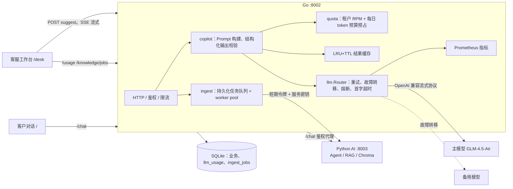

# supportFlow v3.1：Go AI 应用后端

这版把项目重心从「Agent 算法」移到「AI 应用工程」：Go 不只负责订单、退款、会话这些业务数据，还直接承担模型网关、流式输出、用量计量与配额、异步知识入库这些 AI 应用后端必须解决的问题。Python 继续负责 Agent 编排、RAG 和记忆，两边通过已有的服务密钥和内部 RPC 隔离。

## 架构



| 包 | 职责 | 关键实现 |
| --- | --- | --- |
| `backend/internal/llm` | 模型网关 | OpenAI 兼容 SSE 流式客户端；按优先级路由；首字前可重试/切换供应商；三态熔断器；首字超时；结果缓存；Prometheus 直方图 |
| `backend/internal/quota` | 配额 | 每租户令牌桶限流；每日 token 预算「预占→结算」，并发请求不会合计超支 |
| `backend/internal/copilot` | AI 功能 | 客服「建议回复」流式生成；「交接摘要」JSON 结构化输出、校验失败带错误信息修复一次；Prompt 版本由模板内容哈希生成 |
| `backend/internal/ingest` | 异步知识入库 | 任务落库立即返回 202；worker pool 租约领取；按段落分片并逐片 checkpoint；指数退避 + 抖动重试；不可重试错误与超次数任务进入死信，可人工重试 |
| `backend/internal/store` | 数据 | `llm_usage` 计量表与 P50/P95 统计；`ingest_jobs` 队列表；所有状态变化与 SSE 事件同一事务 |
| `frontend/desk.*` | 前端 | 客服工作台「AI 助手」面板（fetch + ReadableStream 解析 SSE）；「AI 运营」页展示用量、延迟分位、网关状态和入库任务 |

## 关键设计取舍

**1. 流式输出下的故障转移边界。** 重试和切换供应商只在第一个 token 到达前发生。一旦有内容推给前端，再换模型会出现重复或前后矛盾的文本，所以中途断流直接返回 `llm_interrupted`，前端保留已显示内容并提示重试。客户端断开时取消上游请求，不计入熔断失败，也不重试。

**2. 首字超时而非总超时。** 每次尝试单独设首字超时（默认 20 秒），首字到达后取消计时，交给请求级总超时（90 秒）。慢模型能被及时切走，正常的长回答也不会被截断。

**3. 熔断器。** 连续 3 次失败打开 30 秒，冷却后只放行一个探测请求（half-open），成功关闭、失败重新打开。401/400 这类请求错误不在同一供应商重试，但会切到下一个供应商，因为它通常是该供应商配置问题。

**4. 配额用「预占→结算」。** 和退款金额占用同一思路：调用前按「估算 prompt tokens + max_tokens」预占，调用后按真实用量结算并释放预占。50 个并发请求测试中，放行数严格等于剩余预算可容纳的数量。当天已用量在进程首次访问或跨 UTC 日时从 `llm_usage` 加载，重启不会把预算清零。

**5. 缓存键包含一切会影响输出的东西。** 租户、功能、Prompt 版本、模型路由链、完整消息、参数。会话来了新消息、改了 Prompt、换了模型，键都会变，不会返回过期结果。只缓存校验通过的完整结果；`?fresh=1` 跳过读缓存用于「重新生成」。缓存命中也写一条 0 token 的用量记录，命中率可以直接统计。

**6. Prompt 版本化。** 版本号是 `suggest@<模板 SHA-256 前 8 位>`，改模板自动换版本，每条用量记录都带版本，便于对比不同 Prompt 的成本和延迟。

**7. 结构化输出。** 摘要要求 JSON 对象，Go 端校验字段、枚举和长度；不合格时把模型原输出和具体校验错误作为下一轮输入修复一次，仍不合格返回 502，不替模型补字段。

**8. 上下文预算与注入防护。** 会话从新到旧按 token 预算截断（默认 3000），单条超长消息截断；会话放在 `<transcript>` 中，系统提示声明会话是数据而不是指令。

**9. 异步入库的可靠性。** 任务和正文先落库再处理；领取时用条件 UPDATE 设置租约，worker 崩溃后租约过期可被其他 worker 接管；每完成一片写 checkpoint，重试从失败分片继续；相同文档相同内容重复提交返回原任务；成功后清除正文只保留哈希。worker 以提交人身份签发 5 分钟令牌调用 Python，用后立即撤销，Python 侧的管理员权限校验保持不变。

**10. 计量与可观测性。** 每次调用记录供应商、模型、Prompt 版本、状态、prompt/completion tokens、总耗时、首字耗时、是否缓存、是否估算。供应商不返回 usage 时按中文 1 字约 1 token、其他字符约 4 字符 1 token 估算并标记。`/metrics` 暴露请求结果、token、缓存命中、耗时与首字直方图、熔断状态和入库队列深度。

## API

| 接口 | 权限 | 说明 |
| --- | --- | --- |
| `POST /copilot/conversations/{id}/suggest[?fresh=1]` | 客服 | SSE：`delta`（增量文本）、`done`（供应商、模型、tokens、首字/总耗时、缓存、Prompt 版本）、`error`。流开始前的错误（权限、配额、未配置）返回普通 JSON |
| `POST /copilot/conversations/{id}/summary` | 客服 | 结构化摘要 `{summary, intent, sentiment, next_action}` + 调用元数据 |
| `GET /usage?days=7` | 客服/运维 | 总量、按天、按功能（含 P50/P95 耗时、P95 首字）、按模型，以及今日预算与网关状态 |
| `POST /knowledge/jobs` | 管理员 | `{doc_id, title, content}`，新任务 202，重复内容 200 并返回原任务 |
| `GET /knowledge/jobs`、`GET /knowledge/jobs/{id}` | 客服/管理员 | 任务列表、队列分布、单个任务进度 |
| `POST /knowledge/jobs/{id}/retry` | 管理员 | 重新排队死信任务 |
| `GET /health` | 公开 | 新增 `llm_gateway`：各路由供应商、模型、熔断状态 |

## 配置

| 变量 | 默认 | 说明 |
| --- | --- | --- |
| `SF_LLM_PROVIDERS` | 空 | JSON 数组，按优先级：`[{"name":"glm","url":"https://open.bigmodel.cn/api/paas/v4","model":"glm-4.5-air","key_env":"SF_MODEL_KEY"},{"name":"deepseek","url":"https://api.deepseek.com/v1","model":"deepseek-chat","key_env":"SF_FALLBACK_KEY"}]`。密钥只按 `key_env` 读环境变量，不写进 JSON |
| `SF_MODEL_BACKEND` / `SF_MODEL_URL` / `SF_MODEL_KEY` / `SF_MODEL_NAME` | — | 未设置 `SF_LLM_PROVIDERS` 且后端为 `compatible` 时，复用 Python 的模型配置作为单一路由；`fixture` 使用离线替身 |
| `SF_LLM_RPM` | 30 | 每租户每分钟 AI 助手请求数 |
| `SF_LLM_DAILY_TOKENS` | 500000 | 每租户每 UTC 日 token 上限，0 为不限 |

## 运行与验证

```sh
python scripts/start_product.py --fixture --port 18002 --ai-port 18003 --data-dir .runtime/ci-data --source-db .runtime/no-legacy.sqlite3
python scripts/verify_product.py      # 新增：Copilot SSE、结构化摘要、权限、异步入库、用量计量
cd backend && go test -race ./... && go vet ./...
```

本次验证（Linux，fixture 离线模型）：

- Go：40 个测试，`-race` 全部通过（原 14 个）。覆盖流式解析、缺失 usage 估算、截断流、重试后故障转移、4xx 不重试、熔断打开与半开探测、首字超时切换、中途断流不切换、客户端断开、LRU/TTL、并发预算不超支、限流补充、跨日重载、分片确定性、checkpoint 续传、死信与人工重试、过期租约接管、Prompt 构建与注入防护、缓存与 fresh、JSON 修复、SSE 端到端、令牌撤销。
- 端到端：`verify_product.py` 在真实 Go + Python 进程上通过，包含原有业务闭环和新增 AI 后端检查。
- 浏览器：Chromium 无头模式打开 `/desk`，建议回复流式显示、交接摘要、AI 运营页均正常，无页面错误。
- Python：128 个测试通过；`test_jev_intent_benchmark` 需要先下载公开数据集到 `.runtime/datasets/`，在改动前的版本上同样失败。

fixture 只验证工程链路，不代表模型效果；没有对真实模型做压测，文档中的延迟数字都来自 fixture。

## 当前边界

- 配额和缓存是进程内状态，对应现在的单 Go 实例部署；多副本需要把令牌桶和预算预占换成 Redis（`INCRBY` + Lua 原子检查），缓存换成 Redis。
- 缓存是精确匹配，不做语义缓存。
- 入库队列基于 SQLite 条件更新，适合单库；多实例时可换 PostgreSQL `SELECT … FOR UPDATE SKIP LOCKED` 或消息队列。
- 文档重新入库时分片数变少，Python 侧多出来的旧分片不会自动删除。
- 摘要只展示给客服，不会自动写入工单。
