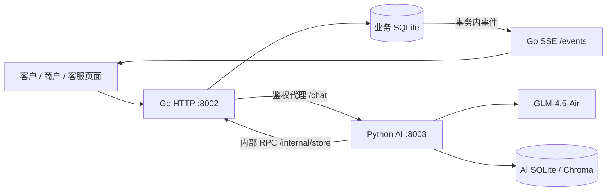

# supportFlow v3：Go 业务后端 + Python AI

> v3.1 在 Go 中加入 LLM 网关、Copilot、用量计量与异步知识入库，见 [Go AI 应用后端](AI_APP_BACKEND.md)。

这版保留原有 Agent、RAG、记忆和执行过程展示，把业务数据的读写统一到 Go，补上人工客服工作台、持久化会话、实时消息和正式账号。

## 启动与入口

本机已经配置 Go 1.27.1、Python 虚拟环境和私有 GLM 配置：

```powershell
.venv-supportflow/Scripts/python.exe scripts/start_product.py
# 修改代码后重新构建并重启这套服务
.venv-supportflow/Scripts/python.exe scripts/start_product.py --restart
```

`scripts/start_glm.py` 默认也启动这套架构；只有显式加 `--legacy` 才启动原单体服务。启动器不会抢占其他进程使用的端口。

| 入口 | 用途 |
| --- | --- |
| `http://127.0.0.1:8002/` | 客户对话、会话历史、执行过程 |
| `http://127.0.0.1:8002/admin` | 订单新增、状态更新、删除恢复、退款审核与沙箱结算 |
| `http://127.0.0.1:8002/desk` | 会话接待、人工回复、工单、成员、操作记录 |
| `http://127.0.0.1:8002/lab` | Agent 编排、知识与 Skills、工具和已有评测报告 |
| `http://127.0.0.1:8002/login` | 正式租户账号登录 |

默认本机沙箱直接进入演示身份：客户 `alice`、商户 `merchant`、客服 `operator`。演示客户可以查询 demo 租户的全部订单。真正的客户账号只允许访问自己的订单和会话。演示身份端点只在显式开启演示模式、回环地址、同源请求和专用请求头同时满足时开放。

## 服务与数据归属



| 模块 | 实现 | 关键约束 |
| --- | --- | --- |
| API 与业务 | `backend/internal/app`、`backend/internal/store` | Go 是运行期间业务数据库的唯一写入者 |
| 账号权限 | bcrypt 密码、随机会话令牌的 SHA-256 摘要 | 租户来自已认证身份；客户、客服、财务、运维、管理员权限区分；停用账号即时撤销令牌 |
| 订单 | 状态机、整数分金额、版本号、软删除 | 不允许越级履约、过期版本更新、退款占用期间删除或发货 |
| 退款 | 申请 → 待审 → 批准/拒绝 → 沙箱结算 | 审批和申请人分离；占用余额防止超退；申请幂等、结算幂等；与审计同一事务 |
| 会话 | 历史、消息、执行详情、会话租约 | AI 处理中拒绝人工接管；接管后新消息只保存并等待人工；恢复 AI 后读取人工回复与工单处理结果 |
| 人工工单 | open → assigned → resolved → closed，可重新打开 | 版本冲突校验；解决说明写回原会话 |
| 实时更新 | SSE + 持久化 events 表 | 业务变化和事件同一事务提交；按事件 ID 续传；客户只能订阅自己的会话事件 |
| Agent、RAG、记忆 | 保留 Python 编排、共享工具、Chroma 和 Skills | 工具中的订单/退款/工单调用通过 RemoteStore 请求 Go；禁止 Python 直接写业务账本 |
| 运维 | `/health`、`/ready`、受权限保护的 `/metrics`、JSON 日志 | 模型不可用时业务接口仍可使用；限流、超时、并发上限；内部 RPC 操作白名单 |

Python 私有端口只接受带服务密钥的 AI 请求，业务路由直接拒绝。密钥自动保存在 Git 忽略的 `.runtime/product-service.key`，不发送到浏览器。Go 转发 AI 请求时注入密钥，Python 再通过内部 RPC 读取当前业务事实。

退款审批不会覆盖历史聊天内容；客户下一轮询问进度时重新读取 Go 的实时状态。`approved` 表示审核通过，`settled` 才表示沙箱入账完成。

## 人工接待流程

1. 客户在对话中请求人工，Agent 创建工单，会话变为「待接入」。也可以在客服工作台接入任意现有会话。
2. 客服点击「接入会话」，当前会话进入人工模式。客户继续发送的消息不调用模型。
3. 客服发送回复，客户窗口通过 SSE 自动更新，回复标为人工客服。
4. 客服解决工单，处理结果写入会话；点击「恢复 AI」，后续请求回到 Agent。

工单状态与接待模式分开维护：解决/关闭工单不隐式把客户切回 AI，客服可在确认处理完成后明确恢复 AI。

## 数据迁移与回退

首次启动从 `data/supportflow-glm.sqlite3` 通过 SQLite backup API 创建一致性快照，再初始化：

- `data/supportflow-business.sqlite3`：保留原订单、退款、会话、消息、用户画像和审计；Go 增加账号、会话接待模式、事件、消息详情等表。
- `data/supportflow-ai.sqlite3`：只迁移知识数据。沿用原 Chroma 路径，保留向量知识与记忆。
- `data/backups/before-go-*.sqlite3`：完整迁移前快照。
- `data/go-migration.json`：迁移来源、备份和目标路径。

启动器不会覆盖已存在的目标数据库，不会重建或修改商户现有订单。原数据库保留。新架构运行后产生的数据在新业务库中，不能直接切回旧库而声称没有数据损失；回退时先停止服务并备份新库，明确选择要恢复的数据版本。

运行信息与日志：`.runtime/product-8002.json`、`.runtime/product-go-8002.log`、`.runtime/product-ai-8002.log`。模型私有配置仍使用 `.runtime/glm.env`。

## 正式账号与容器

本机正式账号模式：首次设置 `SF_ADMIN_PASSWORD`（10–72 字节），可选 `SF_ADMIN_TENANT` / `SF_ADMIN_USER`，执行 `start_product.py --no-demo`。已有管理员不会在重启时被覆盖。登录 `/login` 后可在「客服工作台 → 成员」创建客服、财务和客户。创建正式订单时可以填写客户账号。

容器定义在 `compose.product.yml`：Go 和 Python 独立镜像、独立数据卷；仅公开 Go 的本机 8002 端口；关闭免登录演示，通过初始管理员登录。启动前设置 `SF_SERVICE_KEY`、`SF_ADMIN_PASSWORD`、`SF_MODEL_URL` 和 `SF_MODEL_KEY` 等环境变量：

```sh
docker compose -f compose.product.yml up --build -d
```

容器配置已提供，本次验证在 Windows 本机完成，未宣称完成容器部署或生产压测。不要把本机数据库复制到运行中的容器数据库文件上。

## API 摘要

所有业务接口使用 `Authorization: Bearer <token>`，除演示登录和健康检查外均鉴权。

| 接口 | 权限 / 行为 |
| --- | --- |
| `POST /auth/login`、`POST /auth/logout`、`GET /auth/me` | 密码登录、撤销会话、当前身份 |
| `GET/POST /users`、`PATCH /users/{id}` | 管理员列出/创建成员、停用/恢复账号 |
| `GET /conversations`、`GET /conversations/{id}` | 客户自己的会话，客服租户内全部会话 |
| `POST /conversations/{id}/takeover`、`/resume-ai` | 客服操作，JSON 中提供当前 `version` |
| `POST /conversations/{id}/messages` | 接待中的客服回复，`message` + `request_id` |
| `POST /chat` | `message`、可选 `conv_id`、`request_id`；人工模式下直接保存消息 |
| `GET /events?after={event_id}` | SSE，令牌通过请求头传入，不放在 URL |
| `GET /merchant/overview`、`GET/POST /merchant/orders` | 商户概况、订单查询与新增 |
| `PATCH/DELETE /merchant/orders/{id}`、`POST .../{id}/restore` | 状态修改、软删除、恢复 |
| `POST /refunds`、`POST /refunds/{id}/approval`、`POST .../{id}/settle` | 申请、财务审批、沙箱结算 |
| `GET/POST /tickets`、`GET/PATCH /tickets/{id}` | 工单查询、创建、流转 |
| `GET /stats`、`GET /audit`、`GET /metrics` | 业务统计、审计、Go 请求指标 |
| `POST /mcp/` | 已认证的 MCP 统一工具服务，经 Go 代理 |
| `POST /copilot/conversations/{id}/suggest`、`/summary` | 客服；建议回复 SSE 流式，交接摘要结构化 JSON（v3.1） |
| `GET /usage` | 客服/运维；AI 调用量、tokens、缓存命中、P50/P95、预算（v3.1） |
| `GET/POST /knowledge/jobs`、`GET /knowledge/jobs/{id}`、`POST .../{id}/retry` | 异步知识入库任务（v3.1） |

## 验证与面试演示

```powershell
.runtime/toolchains/go/bin/go.exe -C backend test ./...
.runtime/toolchains/go/bin/go.exe -C backend vet ./...
.venv-supportflow/Scripts/python.exe -m pytest tests -q --basetemp=.runtime/pytest-product-check
# 独立的离线验收数据，不改正式演示订单
.venv-supportflow/Scripts/python.exe scripts/start_product.py --fixture --port 18002 --ai-port 18003 --data-dir .runtime/product-test --source-db .runtime/no-source.sqlite3
.venv-supportflow/Scripts/python.exe scripts/verify_product.py
```

`--fixture` 明确使用离线替身，只验证工程链路，不能代表 GLM 效果。验收脚本创建独立命名的沙箱订单，检查状态更新、退款最新状态、幂等重试、人工接管、SSE、MCP、知识审计、账号撤销与删除恢复。CI 配置在 `.github/workflows/product.yml`，Linux Go job 额外使用 race detector。

本次本机验证：14 个 Go 测试、Go vet、123 个 Python 测试、完整 HTTP 验收链路；真实 GLM-4.5-Air 复合请求完成 5 次模型调用，订单列表与知识检索成功，无失败项。

面试可以围绕三条闭环展示：修改订单状态后 Agent 读到最新事实；退款并发与重复请求不重复占款/入账；AI 转人工并实时回复，再恢复 AI 保留上下文。代码和证据对应业务行为，不需要把通用大模型推理过程当作业务执行记录。

当前明确边界：SQLite 单 Go 实例，退款仍是沙箱；SSE 是持久化事件续传，不是消息队列；未实现真实支付渠道、短信邮件、SLA 自动分配、附件上传或多副本数据库扩展。现有前端继续使用原生 JavaScript，避免把框架重写混入本次业务迁移。
