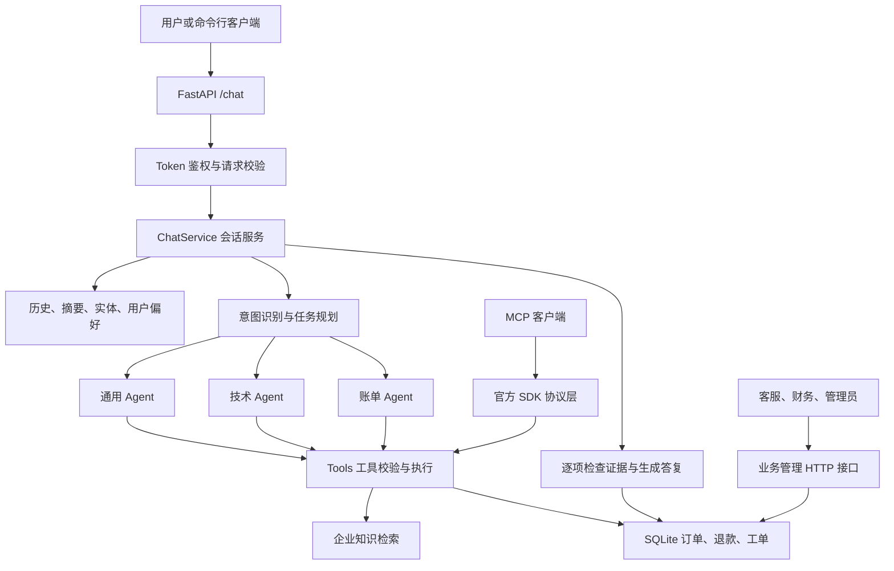
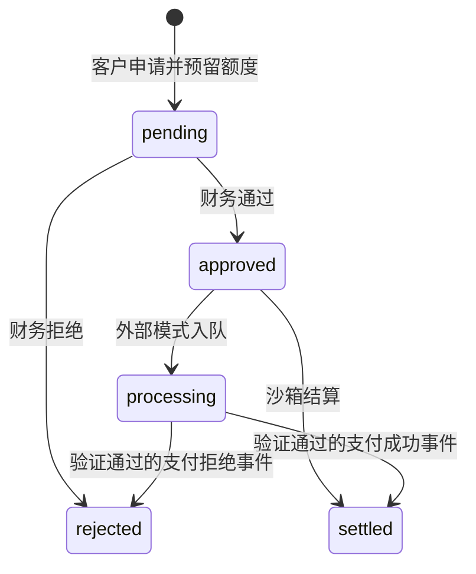

# EchoMind 项目完整讲解

本文按 **2026-09-20 工作区中的实际代码** 编写。先讲当前运行流程，再解释模块、数据、接口、测试和历史实现。所有“已实现”均指代码具备的能力；历史模型成绩单独标明，不等于本次重新评测。

## 目录

1. [项目做什么](#s01)
2. [目录与两代实现](#s02)
3. [一次请求如何走完](#s03)
4. [身份、权限和请求格式](#s04)
5. [意图识别与实体提取](#s05)
6. [路由、任务拆分与并行](#s06)
7. [Agent 如何调用工具并判断完成](#s07)
8. [工具管理：校验、缓存、熔断](#s08)
9. [订单与退款账本](#s09)
10. [人工工单闭环](#s10)
11. [外部支付适配](#s11)
12. [知识库与 RAG](#s12)
13. [多轮记忆与会话一致性](#s13)
14. [Skill 业务规则](#s14)
15. [模型适配与费用](#s15)
16. [MCP 协议接入](#s16)
17. [全部 HTTP 接口](#s17)
18. [数据库表与数据对象](#s18)
19. [监控、追踪与错误状态](#s19)
20. [评测设计与数据集](#s20)
21. [已有实验结果](#s21)
22. [自动化测试验证了什么](#s22)
23. [配置、启动与部署](#s23)
24. [旧版代码如何工作](#s24)
25. [逐文件职责与主要函数](#s25)
26. [当前实现的准确边界](#s26)

<a id="s01"></a>
## 1. 项目做什么

EchoMind 是一个客服后端：**理解用户诉求，查询企业知识和订单，提交退款申请或人工工单，并保留处理记录。** 当前默认运行的版本叫 SupportFlow v2。

普通聊天模型只能生成文字。这个项目在模型外面增加业务程序，使“查到订单”“提交申请”“转人工”都有可以核对的工具结果和数据库记录。

| 用户诉求 | 当前程序会做什么 | 完成的含义 |
|---|---|---|
| 查询订单 | 根据登录身份查询 SQLite 订单表 | 返回实际订单状态和金额 |
| 登录失败、接口报错 | 查知识库，生成排查步骤 | 给出有依据的建议，不表示故障已经修复 |
| 申请退款 | 校验订单归属、金额和可退余额，创建申请 | 申请进入 `pending`，等待财务审核 |
| 退款审批与结算 | 财务通过专用接口操作 | 沙箱模式修改测试账本；外部模式等待支付事件 |
| 转人工 | 创建关联当前会话的工单 | 工单进入队列，客服后续接单、解决、关闭 |
| 发票、物流、账户等咨询 | 检索规则或交给相应 Agent 解释 | 没有接入自动开票、真实物流或账户修改系统 |
| 一句话包含多件事 | 拆成多个子任务，分别执行并逐项回复 | 每项都有自己的完成状态与证据 |
| 多轮继续讨论 | 读取历史、已知实体、摘要与偏好 | 能继续使用之前提供的订单号等信息 |

这里的 **Agent** 是“带角色提示词、业务规则和工具范围的处理程序”。不同 Agent 可以使用同一个大模型，并不代表训练了多个模型。

项目主要提供 HTTP API、MCP 接口和命令行聊天客户端。Swagger 是接口调试页面，仓库没有独立的完整客服前端。

<a id="s02"></a>
## 2. 目录与两代实现

### 2.1 当前运行的结构



| 位置 | 作用 |
|---|---|
| `api/main.py` | 默认入口，创建 SupportFlow 应用 |
| `supportflow/` | 当前主线：服务编排、事务工具、检索、协议、支付和配置 |
| `core/` | 意图识别、Skill 加载、模型文本提取；新版继续复用 |
| `agents/` | 原有 Agent 和路由器；新版复用类型与路由判断，替换执行主体 |
| `skills/` | 通用、技术、账单三类业务 SOP 文本 |
| `tests/` | 程序行为、权限、并发和协议测试 |
| `evaluation/` | 模型质量评测、数据集、报告比较 |
| `scripts/` | 初始化、模型准备、启动、演示、评测与打包 |
| `memory/`、`mcp/`、`monitor/` | 旧版记忆、工具管理和在线监控实现 |
| `docs/`、`data/demo_*` | 交接说明、接口/数据库快照、合成样例 |
| `评测结果/` | 已保存的历史模型实验结果与源码快照 |
| `artifacts/`、`.runtime/` | 本地运行产物，通常被 Git 忽略 |
| `项目解读与面试指南/`、`wiki/` | 既有说明材料，不是运行代码 |

### 2.2 为什么必须区分新旧版本

`api/main.py` 现在直接调用 `supportflow.api.create_app()`。旧入口被归档为 `api/legacy_main.py.txt`，默认不会执行。

| 内容 | 旧版 EchoMind | 当前 SupportFlow v2 |
|---|---|---|
| 用户身份 | 请求体传 `user_id` | Bearer token 决定租户、用户和角色 |
| 工具 | 进程内 `MCPToolManager` 注册 handler | 严格工具执行层，另有官方 MCP SDK 服务 |
| 订单、退款、工单 | 主要依赖说明和文本回答 | SQLite 账本与状态转换 |
| 记忆权威来源 | Redis 工作记忆 | SQL 消息日志与会话状态 |
| 多 Agent | 按领域派发、拼接回复 | 显式子任务、工具证据、补做与逐项渲染 |
| 监控 | 定时采样、告警、路由降权 | 实际 HTTP 指标和请求 trace |
| 评测 | 编排器回复加 LLM 打分 | 鉴权 HTTP、工具、业务状态共同判分 |

新版复用旧路由器，**不代表旧版的每条执行路径都会在新版运行**。例如默认 `multi` 直接执行对应 `ToolAgent._call_llm()`，没有经过旧版 `BaseAgent.handle()` 的统计与通用降级逻辑。

<a id="s03"></a>
## 3. 一次请求如何走完

主要代码：`supportflow/api.py`、`service.py`、`planning.py`、`tools.py`、`store.py`。

以用户 alice 的请求为例：

> 登录报401，请查询订单 ORD1001，并帮我申请退款10元，另外转人工客服。

假设 `ORD1001` 属于 alice，总额为 5000 分，没有退款或额度预留。

### 3.1 接收与恢复上下文

1. 客户端发送 `Authorization: Bearer <token>`，请求体包含 `message`、`request_id`，续聊时再传 `conv_id`。
2. 服务端查 token 摘要，确认身份、有效期和撤销状态。
3. `ChatService.chat()` 对“消息、会话 ID、方案 variant”计算请求指纹。已完成的相同请求直接回放。
4. 没传 `conv_id` 时，由租户、用户、请求 ID 生成稳定的会话 ID。
5. 获取该会话的执行租约；同一会话已有请求执行时返回冲突。
6. 读取最近 SQL 消息、会话实体、用户偏好和可用摘要，再做意图识别。

### 3.2 规划与执行

该句会形成四项任务：

| 子任务 | 执行角色 | 必须取得的工具证据 |
|---|---|---|
| 技术问题 | technical | `knowledge_search` 成功且有知识条目 |
| 订单查询 | billing | `order_lookup` 成功 |
| 退款申请 | billing | `refund_request` 成功，或取得明确的余额不足拒绝 |
| 人工工单 | general | `ticket_create` 成功 |

这些任务由 `asyncio.gather()` 并发执行。每个任务内部仍按“模型提出调用 → 程序执行工具 → 模型读取结果 → 回答”的顺序运行。

技术任务收到的是筛出的技术语句，当前请求的订单实体也会被去掉。原始完整请求仍由服务保存，用于退款授权、统一退款原因和工单摘要。

退款工具把 10 元对应为 1000 分。数据库确认归属和可退余额后，创建 `pending` 申请，预留 1000 分。此时订单 `refunded` 仍为 0，因为尚未结算。

### 3.3 核对与保存

1. 每个任务检查自己的工具结果与答复是否满足要求。
2. 缺少证据时，在剩余轮数内要求原任务补做。
3. 最后按任务顺序输出四个板块，失败的板块也保留。
4. 在一次 SQL 事务中保存用户消息、助手答复、会话状态、画像、请求回放结果和 trace。
5. 再更新可选 Redis 缓存、Chroma 摘要与画像投影；投影失败会记入 trace。
6. 释放会话租约，返回结果。

可能的答复结构是：

```text
【技术问题】
根据知识库，401 与认证失败有关……给出排查步骤和来源。

【订单查询】
订单 ORD1001 当前为 paid……

【退款申请】
10 元退款申请已提交，等待审核；当前为沙箱账本……

【人工工单】
已创建工单 tk_...，状态为 open，等待接单。
```

文字由模型生成，工具状态以数据库为准。`completed` 表示本轮要求的任务完成；退款任务完成通常只是提交申请，人工任务完成通常只是创建工单。

<a id="s04"></a>
## 4. 身份、权限和请求格式

### 4.1 身份对象

`Principal` 是不可变的数据对象，包含：

| 字段 | 含义 |
|---|---|
| `tenant` | 租户，即数据所属组织 |
| `user` | 该租户中的用户 |
| `roles` | 角色集合，默认只有 `customer` |

`Principal.require(role)` 检查角色；`admin` 可以通过角色检查。但退款申请仍必须属于本人，管理员也不能代他人绕过该归属限制；申请人也不能审批或执行自己的退款。

### 4.2 Token 的实际实现

`Store.issue_token()` 使用 `secrets.token_urlsafe(32)` 生成随机 token。数据库只保存其 SHA256 摘要、身份、角色、过期时间和撤销标记。

每次认证对传入 token 再做 SHA256，然后查表。因此可以立即撤销 token，不需要等待某个自包含凭证自然到期。

这不是 JWT，也没有实现登录密码校验、企业 SSO 或完整 OAuth 身份提供商。首次管理员和演示用户由本地初始化脚本创建；已有管理员可通过接口签发同租户 token。

### 4.3 五种角色

| 角色 | 主要权限 |
|---|---|
| customer | 本人聊天、订单、退款申请、工单 |
| staff | 同租户订单与工单队列，工单处理 |
| finance | 同租户订单与退款列表，退款审批、执行 |
| ops | HTTP 指标、外部支付发送和对账 |
| admin | 角色检查的管理权限，知识导入、Skill 重载、token 和审计 |

**用户角色与 Agent 角色是两回事。** `billing` Agent 可以提出退款申请，但不会因此拥有登录用户没有的权限，更不能调用财务审批或结算工具。

### 4.4 聊天请求

```json
{
  "message": "请查询订单 ORD1001",
  "request_id": "demo-request-001",
  "conv_id": null
}
```

| 字段 | 约束 |
|---|---|
| `message` | 必填，1～6000 字符 |
| `request_id` | 必填，8～100 字符，只允许字母、数字、下划线和连字符 |
| `conv_id` | 可空；非空时 1～80 字符，只允许上述字符 |

Pydantic 设置 `extra="forbid"`，所以请求体不能额外塞入 `user_id`、`tenant`、`roles` 等字段。

幂等表示“同一次操作重复提交，结果仍只有一份”。客户端重试必须保留原 `request_id` 和原请求体；不同消息要换新 ID。

<a id="s05"></a>
## 5. 意图识别与实体提取

主要代码：`core/intent_recognizer.py`。

意图识别回答“用户主要想做什么”；实体提取回答“涉及哪个订单、多少钱、哪个错误码”。两者为后续路由提供输入，不直接执行业务。

### 5.1 意图种类

代码定义 19 个意图值：

| 类型 | 意图值 |
|---|---|
| 通用 | `query`、`complaint`、`request`、`greeting`、`feedback`、`other` |
| 宽泛领域 | `technical`、`billing`、`account`、`escalation` |
| 细分业务 | `order_status`、`logistics`、`refund`、`invoice`、`payment_issue`、`account_security`、`technical_login`、`technical_crash`、`human_handoff` |

细分意图同时映射到大组：订单/物流属于 query；退款/发票/支付异常属于 billing；登录/崩溃属于 technical；账户安全属于 account；转人工属于 escalation。

`IntentResult` 返回主意图、融合置信度、紧急度、意图组、实体、理由、耗时和各路得分。它只返回一个主意图，复合任务由后面的规划器补充拆分。

### 5.2 LLM、向量、规则三条识别路径

**LLM 路径**：提示词提供每类一个示例，以及最近 3 条历史消息，要求返回 `intent/confidence/reasoning` JSON。未知标签转 `other`；请求或解析失败标记 `failed`。

**向量路径**：将当前消息与各类示例比较，选余弦相似度最高的类别。模板向量首次使用时生成并缓存。有兼容的 `embeddings.create()` 时尝试远端向量；否则把字符 1、2、3 元组哈希到 256 维，作为轻量文本相似度。该哈希向量不是训练出来的语义模型。

**规则路径**：先匹配退款、订单、登录等细分关键词，再匹配宽泛关键词。命中一个关键词得 0.5，每多一个加 0.25，上限 1.0；得分相同时保留先遇到的类别。

### 5.3 当前主线实际使用哪几路

识别器只要收到非空 `base_url`，就禁用向量路径。新版总是传 `settings.model_url`，默认和通常配置都非空，因此当前主线通常是：

```text
某意图得分 = LLM 对该意图的置信度 × 0.85
           + 规则对该意图的置信度 × 0.15
```

只有启用向量分支时，才使用 LLM 0.7、向量 0.2、规则 0.1。得分低于默认阈值 0.5 时返回 `other`。

例如两条路径都判定退款，LLM 置信度 0.9，规则为 0.5，融合分数为 `0.9×0.85 + 0.5×0.15 = 0.84`。这只是启发式评分，不是经过概率校准的正确率。

两个特殊规则：

- LLM 失败时，优先用有效向量结果，否则用有效规则结果；该分支不再走正常加权阈值。
- 如果胜出的是宽泛大类，规则给出了同组的细分意图，且规则至少 0.5、原得分小于 0.8，可以细化标签。

### 5.4 实体与紧急度

| 实体 | 提取方式与边界 |
|---|---|
| `order_id` | 匹配“订单号/order/#”后的标识，或独立的 `ORD` 加数字 |
| `amount` | 匹配货币符号或元、块、人民币/美元等文字；结果仍是字符串 |
| `date` | 今天、明天、本周及常见日期格式 |
| `error_code` | 4xx、5xx 或 `ERR...` 格式 |
| `product` | 当前固定为空列表，没有产品抽取实现 |

注意：能抽取某种金额表达，不表示退款授权也支持它。聊天退款的执行保护更严格，只接受当前原文中“数字 + 元”对应的分值。

紧急度分 low、medium、high、critical。紧急/urgent/asap/立刻等词优先触发 critical；转人工意图默认 high；投诉默认 medium。

### 5.5 缓存与 learn

缓存键使用清洗后的完整消息和传入历史计算 MD5。缓存达到 1000 项时删除最早插入的 500 项；没有 TTL，也没有命中后移动顺序，因此不是严格的 LRU。

`learn(message, correct)` 将纠正样本追加到内存模板、清除对应模板向量与识别缓存。它没有训练模型，也没有持久化；LLM 示例仍只取每类第一条，因此追加样本主要影响向量分支。

<a id="s06"></a>
## 6. 路由、任务拆分与并行

### 6.1 领域路由

`AgentOrchestrator._route_decision()` 先处理紧急度与人工意图，再为 general、technical、billing 打分。

| 信号 | 加分规则 |
|---|---|
| 通用类意图 | general 初始 0.1，再加 0.55 |
| 技术类意图 | technical 加 0.75 |
| 账单、账户类意图 | billing 加 0.75 |
| 技术/账单关键词 | 每个加 0.18，各自最多加 0.45 |
| 通用关键词 | 每个加 0.12，最多加 0.35 |
| 错误码实体 | technical 加 0.2 |
| 金额实体 | billing 加 0.15 |
| 订单实体 | general 加 0.1 |

最高分是主 Agent；其他非 general 角色同时满足“至少 0.45、至少为主分的 55%”时，可作为辅助 Agent。返回的路由置信度最多为 1.0。

### 6.2 默认 multi 还会建立任务清单

`plan_tasks()` 是规则规划器，不是另一个规划大模型。它按固定顺序识别技术、订单、退款、人工、发票，找不到时创建 general 任务。

| 任务 | 触发条件概括 | 职责和必需工具 |
|---|---|---|
| `technical` | 登录、崩溃、超时、带语境的错误码等 | 只做排查；必须查知识 |
| `order` | 已有订单实体且提到订单/支付等；若同时退款，还需查询、核实等表达 | 查询实际订单 |
| `refund` | 提到退款、有明确申请意愿、有订单、当前句含金额“元” | 提交退款申请 |
| `refund_policy` | 提到退款但执行信息或意愿不齐 | 查规则或追问 |
| `handoff` | 命中转人工、人工客服、human agent、紧急等 | 创建人工工单 |
| `invoice` | 提到发票、开票、invoice | 查规则，说明所需信息与人工审核 |
| `general` | 没有命中以上任务 | 按默认角色完整处理 |

错误码规则要求 HTTP、接口、错误等语境，减少把“退款500元”误判为服务器错误。但旧意图规则及领域评分仍含简单的 `500` 子串判断，两层规则并非完全相同。

### 6.3 为什么要保留每项任务

`Subtask` 记录 `id/kind/agent/title/instruction/required_tools/status/answer/observations/attempts/missing`。

这些字段分别说明“要做什么、谁做、需要什么证据、做到了哪一步、还缺什么”。因此一项失败时，其余结果仍能返回，不会把整句请求只归为一个主意图后遗漏其他诉求。

技术任务会按标点和“同时、另外、顺便”等词拆分原句，只保留技术部分。其他类型仍收到完整当前消息。技术任务的上下文仍可能包含历史订单信息，所以这是职责收窄，不是彻底的信息隔离。

### 6.4 三种运行方案

| 方案 | 执行方式 | 检索 |
|---|---|---|
| `multi` | 显式任务拆分，各任务检查证据，固定分段输出 | 查询改写与可选重排 |
| `single` | 一个 general Agent，但工具权限扩展到全部五种业务工具 | 单次检索，不改写、不重排 |
| `legacy_multi` | 使用旧式领域路由派发，必要时模型自由合并 | 增强检索 |

`single` 和 `legacy_multi` 的转人工分支会先建工单并直接返回，可能跳过同句的其他诉求。默认 `multi` 把人工作为独立任务，能与其他任务一起执行。

`legacy_multi` 仍使用新版工具保护和模型适配，并非完整运行历史旧代码。对比 `single` 与 `multi` 同时改变了拆分、SOP 范围和检索策略，结果差异不能全归因于并行。

并行发生在一次请求的任务之间，主要节省等待模型或工具的时间。一次任务内的工具数组按顺序执行；模型调用数也可能增加，因此并行不保证延迟和成本一定下降。

<a id="s07"></a>
## 7. Agent 如何调用工具并判断完成

主要代码：`supportflow/service.py` 的 `ToolAgent`。

### 7.1 模型只提出操作，程序负责执行

模型返回如下结构：

```json
{
  "answer": "",
  "tool_calls": [
    {"name": "order_lookup", "arguments": {"order_id": "ORD1001"}}
  ]
}
```

`AgentTurn` 要求 `answer` 为字符串、`tool_calls` 最多 3 项，拒绝额外字段。程序解析后逐个执行，结果作为“仅数据”的消息放回对话，再让模型生成答复。

这里的 `tool_calls` 是项目定义的 JSON 格式，模型适配层没有使用提供商原生的 function calling 消息协议。MCP 则是另一个面向外部客户端的协议入口。

### 7.2 轮数与重复控制

默认 `max_tool_rounds=3`，循环是 `range(3+1)`，所以每个 Agent 最多 4 次生成机会。最后一次会要求停止工具调用；若仍返回调用，则报预算耗尽。

格式错误时，程序在剩余轮数内要求重写 JSON。空答复直接视为错误。格式修复、缺失证据补做也占用同一轮数预算，不另开无限循环。

单个任务用 `seen` 阻止完全相同的“工具名 + 参数”重复执行，包括此前失败的相同调用。一次请求的多个任务又共享结果字典和按参数建立的异步锁，只复用成功结果。

### 7.3 完成检查

`Subtask.gaps()` 检查：

- 必需工具是否成功执行。
- 需要知识时是否真的返回知识条目。
- 答复至少 10 个非首尾空白字符，不能只是“已完成”等占位词。
- 技术答复是否包含排查行动词，是否混入订单、退款、工单职责。
- 退款成功申请后是否明确说明待审核，避免把提交申请说成到账。

只有“余额不足”这种 `BusinessRejection`，且答复明确表达拒绝时，才可按 `denied` 正常结束。普通工具超时、越权或参数错误不会自动变成业务完成。

这些规则能检查必要条件，不能证明所有自然语言都正确。例如出现了“待审核”不代表句子里的所有金额和承诺都已被严格核对。

### 7.4 退款意愿与参数保护

程序从用户当前原文识别“申请/我要/请/帮我/确认”等与退款的组合，并处理“不要/暂不/别/do not”等否定表达。

执行退款前再检查：

1. 工具中的订单号属于会话已识别订单实体。
2. 金额必须等于原文中某个“数字 + 元”乘以 100 后的整数分。
3. 当前请求有退款意愿。
4. 工具权限、数据库归属和可退额度全部通过。

金额转换使用 `Decimal`，避免浮点数乘 100 的精度误差。订单号可以来自历史，金额授权只来自当前原句。规则不能完整理解“这笔先退一半”等任意自然语言。

退款原因统一替换为原始请求前 500 字符，工单摘要为前 1500 字符，防止多个 Agent 改写出不同参数而重复写入。

### 7.5 最终回复不再自由合并

`render_tasks()` 逐项保留已核验的答复；未完成项追加缺失说明。这样不会在最后一次自由改写时删掉某项已查到的结果。

任务失败会变为 `blocked`；整轮只要存在非 `completed/denied` 任务，状态就是 `partial`。没有未完成任务但 trace 记录模型或投影故障时，可返回 `degraded`。

<a id="s08"></a>
## 8. 工具管理：校验、缓存、熔断

主要代码：`supportflow/tools.py`。

### 8.1 五个工具

| 工具 | 参数 | 实际工作 |
|---|---|---|
| `knowledge_search` | `query`，1～1500 字符 | 检索当前租户的知识 |
| `order_lookup` | `order_id`，1～100 字符 | 查询可访问订单 |
| `refund_request` | 订单号、整数分金额、原因 | 创建待审核退款 |
| `ticket_create` | `summary`，1～1500 字符 | 在服务提供的会话上创建工单 |
| `ticket_status` | `ticket_id` | 查询可访问工单 |

退款工具金额范围为 1～100000000 分，原因 1～500 字符。HTTP 退款模型只限制正整数，没有相同的 100000000 分上限；最终还受订单余额约束。

参数使用 Draft 2020-12 JSON Schema 校验，拒绝额外字段。模型不能通过参数传 `tenant` 或修改登录身份。

### 8.2 Agent 能力范围

| Agent | 可用工具 |
|---|---|
| general | 知识、订单、建工单、查工单 |
| technical | 知识、建工单、查工单 |
| billing | 全部五种 |
| escalation | 建工单、查工单 |

子任务还会进一步收窄范围，例如 technical 子任务只准查知识，handoff 子任务只准建工单。提示词中的工具列表和实际执行都检查范围。

### 8.3 缓存

只有知识检索使用跨请求的内存缓存，TTL 为 300 秒。缓存键包含租户、用户、角色、参数、是否增强检索、知识版本。

因此不同用户不会直接共享检索缓存，知识更新会使旧键失效。读写缓存均深复制，防止调用方改坏缓存对象。条目超过约 1000 项时整体清理，并非精细 LRU。

订单、退款和工单没有通用 TTL 缓存。写操作依靠数据库幂等，避免把旧写结果错误用于新业务。单请求内的共享成功结果与这层缓存是两种机制。

### 8.4 熔断与超时

熔断器按“租户 + 工具名”保存。连续后端失败 3 次后，10 秒内拒绝执行；恢复期只放行一个探测，成功清零，失败重新计时。

参数校验、能力检查和退款意愿检查在进入熔断器前完成。业务中的 `PermissionError/ValueError` 不累计后端故障，但也不会自动清除此前失败次数。

知识工具超时为 90 秒，其他工具为 10 秒。同步数据库或 Chroma 调用常通过 `asyncio.to_thread()` 放到线程中，减少阻塞异步事件循环。

缓存和熔断状态保存在当前 Python 进程，重启会丢失，多进程也不共享。线程任务被取消后，已开始的同步操作可能继续结束，所以写入正确性仍要依靠事务与幂等。

<a id="s09"></a>
## 9. 订单与退款账本

主要代码：`supportflow/store.py`。

### 9.1 SQLite 是业务事实来源

所有订单、退款和工单最终状态保存在 SQLite。每次 `Store.tx()` 建立连接，启用 WAL，并用 `BEGIN IMMEDIATE` 开始事务；成功提交，异常回滚，最后关闭连接。

WAL 允许数据库通过日志记录修改；`BEGIN IMMEDIATE` 提前取得写事务资格，使“检查余额”和“创建退款”之间不会被另一笔写入插入。当前连读取方法也复用这个事务封装，因此读路径也会申请写事务资格，不能把它描述成高并发只读优化。

`PRAGMA foreign_keys=ON` 已开启，但建表 SQL 没有声明外键关系。归属和状态关系主要由 Python 业务代码校验。

### 9.2 订单字段与访问

订单由 `(tenant, id)` 唯一确定，包含所属用户、总额 `total`、已结算退款额 `refunded`、状态 `status`。金额单位均为分。

客户只能查询本人订单；同租户 staff、finance、admin 可查询其他用户订单。不存在和无权访问均返回权限错误，接口不会单独暴露“这个订单是否存在”。

`seed_order()` 只用于管理员初始化，默认订单状态为 `paid`。没有接入商城下单、物流或支付系统；沙箱退款结算只增加 `refunded`，不会自动把订单 `status` 改成 refunded。

### 9.3 退款额度预留

创建退款时计算：

```text
可申请退款额 = 订单总额
             - 已结算退款额
             - pending、approved、processing 申请的金额合计
```

例如订单 5000 分，已有一笔待审核申请 3000 分，那么只剩 2000 分可再申请。即使没有真正结算，也不能再提交一笔 3000 分。

校验和插入在同一事务中完成。测试同时发起四笔 3000 分申请，确认只有一笔成功，防止并发超额。

### 9.4 状态转换



| 状态 | 含义 | 占用可退额度 |
|---|---|---|
| pending | 等待审批 | 是 |
| approved | 已批准，未执行完成 | 是 |
| processing | 已进入外部支付处理 | 是 |
| settled | 已结算 | 通过订单 `refunded` 计入 |
| rejected | 已拒绝 | 否 |

没有取消退款、重新打开拒绝单或自动过期释放额度的路径。

### 9.5 三层幂等

| 层次 | 键与作用 |
|---|---|
| 聊天请求 | `(tenant, user, request_id)` 加请求指纹，回放整轮结果 |
| 退款申请 | `(tenant, user, idem)` 唯一，避免重复插入 |
| 结算 | 已 settled 时直接返回；支付事件另有去重表 |

HTTP 退款直接使用客户端的 `idempotency_key`。聊天/MCP 工具把“调用请求 ID + 工具名 + 订单号”做 SHA256，作为账本幂等键。

相同退款幂等键若修改订单、金额或原因，数据库返回冲突。工具派生键包含订单号，因此同一个 MCP 原始键换订单会形成不同键；它不是跨所有订单的全局操作锁。

### 9.6 审批与沙箱结算

审批必须有 finance 或 admin 权限，申请人不能审批自己。只有 pending 能变为 approved/rejected。

结算也需要财务权限和非申请人身份，且必须先 approved。沙箱结算在同一事务中增加订单已退额、设置退款为 settled、记录 `sandbox_退款ID` 引用与审计日志，不发生真实资金转移。

退款提交、审批、结算各自是独立事务。整个聊天过程不是一个覆盖所有模型调用和业务工具的大事务：工具写入成功后，即使后续生成失败，业务记录仍可能存在。

<a id="s10"></a>
## 10. 人工工单闭环

工单必须关联当前用户拥有的已有会话。`create_ticket()` 根据 `(tenant, user, idem)` 去重，相同键修改会话或摘要会报冲突。

```text
open → assigned → resolved → closed
等待接单   已分配      已解决      已关闭
```

| 转换 | 必须满足的条件 |
|---|---|
| 创建 open | 会话存在且属于申请人 |
| open → assigned | 操作者有 staff/admin 权限，提供非空 assignee |
| assigned → resolved | 提供解决说明，操作者是受理人或 admin |
| resolved → closed | staff/admin 权限与正确版本 |

每次修改必须传 `version`。初始为 0，修改成功加 1，SQL 用 `WHERE id=? AND version=?` 校验。两个客服基于相同旧版本提交时，只有一个能成功，这叫乐观锁。

resolved 时，程序把“工单已解决：解决说明”作为 system 消息写入原会话。用户再次聊天时能够读到人工结果，形成从机器人到人工再回到会话的闭环。

具体边界：分配时只检查 assignee 非空，没有校验它是否是一个已存在的客服账号；只有解决步骤限制当前受理人，关闭步骤没有相同的受理人限制。代码没有抢单调度、通知客服或客服工作台。

<a id="s11"></a>
## 11. 外部支付适配

主要代码：`supportflow/payments.py`。该模块实现通用接口契约，现有测试使用模拟支付服务，没有真实支付商接入证据。

### 11.1 为什么要有 outbox

数据库事务不能把远程支付 HTTP 请求一起原子提交。如果“钱已退但请求超时”，直接重发新交易可能重复退款。

这里先在本地事务中写入 `payment_outbox` 待发送记录，并把退款设为 processing；之后再发送。这样即使网络失败，系统仍保留“哪笔支付需要处理”的记录。

### 11.2 入队、发送、确认

1. 财务调用 settle，external 模式转入 `Payments.enqueue()`。
2. 检查 HTTPS 支付地址、API key、回调密钥、退款审批状态和申请人隔离。
3. 写入包含退款 ID、租户、订单、金额、CNY 币种的 outbox；退款设为 processing。
4. ops/admin 显式调用 dispatch，领取同租户最多 20 条待办并写入发送租约。
5. 发 `POST {payment_url}/refunds`，`Idempotency-Key` 固定为退款 ID。
6. 对方返回成功状态后，outbox 变为 accepted；订单已退额仍不增加。
7. 收到已验证的最终事件后，才更新最终退款状态和订单已退额。

发送租约为本批数量乘 15 秒再加 30 秒，单次 HTTP 超时 15 秒。失败保留 pending 和错误类型，租约过期后可重试；退款仍为 processing，额度继续预留。没有自动后台发送定时器，也没有自动生成新业务键重试。

### 11.3 回调验证

`POST /payments/events` 不使用用户 Bearer token，而是验证支付签名。原始事件体超过 16384 字节返回 413。

签名为：

```text
HMAC-SHA256(回调密钥, 时间戳 + "." + 原始请求体字节)
```

`X-Timestamp` 与当前时间最多相差 300 秒；使用 `hmac.compare_digest()` 比较签名。

事件必须包含 `event_id/refund_id/tenant/order_id/amount_cents/currency/status/payment_ref`；金额为严格正整数分，币种只能 CNY，最终状态只能 settled 或 rejected。

程序在事务中检查事件是否处理过、退款归属、订单号、金额和允许状态。首次 settled 才增加已退余额；重复同事件返回 duplicate，避免再次入账。

去重表保存事件 ID 与退款 ID。相同事件 ID 指向另一退款会冲突；相同 ID 指向同一退款会直接返回 duplicate，不会重新比较其完整业务载荷。不同事件 ID 对同一已 settled 退款也不会再次增加余额，但相同终态的后续事件仍可更新支付引用。

### 11.4 回调丢失后的对账

ops/admin 调用 reconcile，查询最多 20 条 accepted 待办，向支付服务发 `GET /refunds/{id}`。

- 202：还在处理，保留待确认状态。
- 成功响应：必须携带与回调相同的签名事件，再走 `event()` 的验证和入账逻辑。
- 网络或验证错误：返回该条错误，保留待办。

这使推送回调与主动查询共用一套最终状态核验规则。

<a id="s12"></a>
## 12. 知识库与 RAG

主要代码：`supportflow/knowledge.py`。

RAG 指“先检索资料，再让模型依据资料回答”。知识库提供退款政策、排障说明等文本；订单是否支付、退款是否完成仍须查询业务工具。

### 12.1 文档导入与版本

管理员提交 `id/title/content`。程序每隔 420 字符取最多 500 字符，通常形成 80 字符重叠，减少一句话恰好被切断造成的信息丢失。

```text
文档版本 = SHA256(正文)
片段 ID = SHA256(租户 + 文档 ID + 版本 + 起始位置)
```

SQL 片段 ID 另加 `文档ID:` 前缀，用于一次事务替换该文档的所有旧片段。同样内容重复导入会得到稳定 ID，正文改变则生成新版本。

整个租户知识版本由排序后的片段 ID 和版本集合计算哈希，工具缓存据此失效。标题不参与正文版本和片段 ID，单独改标题不会改变当前知识版本，因此可能继续命中旧标题缓存。

### 12.2 两个后端

| 后端 | 工作方式 | 特点 |
|---|---|---|
| `sqlite` | 将查询切成英文数字词和单个汉字，统计它们是否出现在标题/正文中，按命中数排序 | 轻量词法检索，没有向量模型 |
| `chroma` | 使用 `PersistentClient`，默认嵌入函数生成向量，以 cosine 距离检索 | 真正的向量检索，首次可能需要模型缓存 |

新版 Chroma 使用本地持久化目录，没有消费旧 `CHROMA_HOST/PORT` 服务地址。它没有显式自定义嵌入函数；与意图识别里的 256 维字符哈希向量是不同机制。

Chroma 集合为：

- `supportflow_knowledge`：企业知识，按 tenant 过滤。
- `supportflow_episodic`：历史摘要，按 tenant 和 user 过滤。
- `supportflow_profiles`：用户画像的向量存储投影。

### 12.3 增强检索过程

```text
原始查询
  → 模型给出最多 2 条改写，保留原句并去重
  → 最多 3 路并行检索，每路至少取 5 条
  → 按片段 ID 合并去重
  → 候选超过 k 时，让模型返回相关性排序索引
  → 校验索引、补回遗漏索引、去重
  → 默认返回前 3 条
```

改写增加不同说法的召回机会；重排判断哪些片段更能回答当前问题。它们都会增加模型调用。

返回结果包含 `items/rerank_applied/degraded/backend/queries`，条目中保留 ID、正文、标题、版本和后端相关分数。响应的 `sources` 从成功知识工具结果汇总，按 ID 去重。

改写失败时继续原查询，重排失败时保留合并顺序，并在工具结果 `degraded` 中记录。底层检索本身失败则向上抛错，不会凭空返回知识。模型异常还会进入请求 trace；单纯解析/排序错误未必影响顶层状态，所以完整状态要同时看工具结果。

### 12.4 双写与默认知识

导入先提交 SQL，再更新 Chroma，两者没有跨库事务。搜索 Chroma 后会根据 SQL 有效片段 ID 过滤旧结果，防止返回已替换的旧片段；但向量更新失败仍可能导致新内容暂时检索不到。

内置五篇知识：退款审核、登录故障、订单查询、人工流程、发票办理。`seed()` 只在该租户 SQL 知识数量为 0 时初始化；应用创建本身不会自动给所有租户灌入知识，演示初始化和评测夹具会显式 seed。

这些文档说明的是项目的演示流程。特别是新版不再沿用旧知识里固定“几天到账”的示例承诺。

<a id="s13"></a>
## 13. 多轮记忆与会话一致性

### 13.1 四种上下文

`ChatService._run()` 组装以下上下文交给 Agent：

| 内容 | 来源与数量 |
|---|---|
| `recent` | SQL 最近历史中的最后 8 条消息 |
| `summary` | 当前会话保存的摘要，最多 1000 字符 |
| `profile` | SQL 中该租户该用户的偏好 |
| `recall` | Chroma 检索到的最多 3 条历史摘要 |

`Store.history()` 默认取最近 20 条，按全局递增 seq 查询后恢复成从旧到新。意图识别器内部再取最后 3 条消息；“消息条数”不能直接说成“对话轮数”。

### 13.2 实体记忆

每轮将本轮非空实体合入会话 `state.entities`，新出现的同类实体覆盖旧列表；本轮为空的类别保留旧值。

例如第一轮提供 `ORD1001`，第二轮问“这笔订单现在什么状态”，程序可以沿用订单实体。它不是完整的指代消解系统，多个订单切换仍依赖规则与当前表达。

### 13.3 摘要与长期记忆

满足“读取到的历史至少 14 条，且当前 turn 对 6 取模等于 2”时，模型总结“已有摘要 + 除最后 6 条以外的历史”，要求保留事实、未完成事项和订单号。

生成上限 256 token，保存前再截成 1000 字符。通常从第 8 轮开始，之后第 14、20 轮等触发；是否触发还受实际历史条数影响。

原始 SQL 消息不会删除。Chroma 中摘要 ID 由租户、用户、会话和摘要版本构成；同版本重复投影是 upsert，新版本保留为另一条摘要。

`archive_pending` 会写入状态，但归档调用实际只检查是否存在 summary。因而有摘要后每轮都可能再次 upsert 当前摘要，并非只有新摘要轮次才调用归档。

### 13.4 用户画像

新版只明确提取两个偏好：消息含“用中文”时记录 `language=zh`，含“简短”时记录 `verbosity=brief`。

画像权威来源在 SQL `profiles`，跨会话按租户和用户读取。Chroma 也可保存投影，但当前回复上下文不从 Chroma 画像集合检索。提示词本身也固定要求中文，画像字段不等于完整的多语言偏好系统。

### 13.5 Redis 的定位

配置 Redis 后，缓存键为 `sf:租户:会话`，TTL 24 小时，内容是 turn 和最近历史。

读取时先读 SQL，再比较 Redis 的 turn **和全部缓存历史内容**。只有两者一致才采用缓存。这样人工客服在聊天间隙回写消息后，旧缓存不会遮住新的解决说明。

这层 Redis 当前没有省掉权威 SQL 读取，主要实现可校验的工作记忆投影。Redis 不可用时记录失败并继续用 SQL。

### 13.6 会话租约与提交

会话租约包含随机 owner 和到期时间，期限为 `request_timeout + 30` 秒。获取时检查会话所有者及是否忙；提交时检查租约 owner；finally 只释放自己持有的租约。

租约用于避免同一会话两条请求并发读取旧上下文并互相覆盖。进程崩溃后可等待租约到期，不会永久锁死。提交校验 owner，没有单独重新检查租约时间；若别的请求已接管，owner 变化会阻止旧请求提交。

`commit_turn()` 一次保存双方消息、会话版本、用户画像、请求缓存和 trace。之后再更新可选存储投影并刷新保存的响应，使重放也能看到降级状态。

请求级 Semaphore 默认限制 4 个聊天请求同时进入处理，并不限制为只有 4 个模型 HTTP 调用：一个请求可能有多个并发任务。该限制也不覆盖 `/intents` 和其他业务接口。

<a id="s14"></a>
## 14. Skill 业务规则

主要代码：`core/skill_loader.py`；业务文本位于 `skills/`。

Skill 是可加载的 SOP 文本，用来告诉 Agent 如何处理某类业务。它不会自动执行 Python，也不会新增工具权限。

### 14.1 三份内置规则

| Skill | 匹配角色 | 主要内容 |
|---|---|---|
| 通用客服接待规范 | general | 澄清需求、分流、简洁表达、人工升级和隐私边界 |
| 技术支持处理规范 | technical | 收集故障信息、按步骤排查、记录错误码和 request_id |
| 账单退款处理规范 | billing | 核对订单金额、说明审核流程、避免承诺到账和自动开票 |

Skill 中提到的操作不等于代码已有该能力。例如账单 SOP 讨论订阅和发票，系统却没有取消订阅或生成发票的业务工具。

### 14.2 文件格式

Markdown 可在顶部提供：

```yaml
---
name: 账单退款处理规范
description: 处理账单与退款说明
keywords: 退款,账单,refund
agents: billing
enabled: true
---
```

之后的正文作为提示词。也支持 `.txt` 和 JSON；JSON 正文从 `content` 或 `instructions` 读取。

front matter 是手写的简单 `key: value` 解析器，不是完整 YAML。关键词和角色支持列表或逗号分隔文本，也处理中文逗号、顿号。

### 14.3 加载与匹配

1. 优先递归发现 `SKILL.md`，再加载其他 md/txt/json。
2. 跳过 README、以点开头的文件及已发现的标准文件。
3. enabled 为假则不匹配；指定 agents 时按角色过滤；有 keywords 时任意关键词命中即可。
4. keywords 为空时作为该角色的全局规则。
5. 单个文件解析失败只记录错误，其他文件继续加载。

单份正文默认最多 3200 字符，SkillManager 总预算 5000 字符；新版 `ToolAgent` 又把最终 Skill 文本截为 2200 字符。长 SOP 后半部分未必进入实际提示词，不能按整份文件都生效来理解。

### 14.4 热加载与版本

管理员调用 `POST /skills/reload`，重新扫描本地受管目录。它不是任意远程代码加载，也没有自动监听文件变动。

响应中的 Skill 版本是目录全部文件路径与字节的 SHA256。文件修改而未 reload 时，版本哈希可能已改变，内存中规则却仍是旧内容；该值不是已加载提示词对象的严格快照。

<a id="s15"></a>
## 15. 模型适配与费用

主要代码：`supportflow/model.py`、`pricing.py`。

### 15.1 统一调用入口

业务统一调用 `Model.complete(messages, system, max_tokens, json_mode)`。模型名字、地址、密钥从 Settings 读取。

| backend | 传输方式 |
|---|---|
| compatible | 向 `{model_url}/chat/completions` 发 OpenAI 兼容格式 |
| anthropic | 向 `{model_url}/messages` 发 Anthropic 格式 |
| fixture | 普通 Model 主动报错，测试必须显式注入替身模型 |

适配器使用异步 HTTPX，默认模型请求超时 90 秒，temperature 为 0，不启用流式输出。没有自动切换供应商、自动付费回退或网络重试机制。

`self.messages=self` 和 `create()` 把文本包装成旧调用方熟悉的 `.content` 对象，使旧 `IntentRecognizer` 能复用新版模型连接。旧识别器传来的模型名和 temperature 不会覆盖 Settings：`create()` 最终仍走 `complete()`。

### 15.2 结构化输出

- 支持 JSON Schema 的兼容服务：发送 `response_format=json_schema`。
- 不支持 Schema 但支持 JSON object：把 schema 写进系统提示词，发送 `json_object`。
- 普通 JSON 请求：发送 `json_object`。
- Anthropic 分支：不使用上述 response_format，主要依靠提示词和应用层校验。

`parse_json()` 只去掉外层 Markdown JSON 代码围栏，再调用 `json.loads()`，不会擅自补字段或替换成预期答案。返回文本还会移除完整的 `<think>...</think>` 区块。

本地 Qwen 配置可传 `chat_template_kwargs.enable_thinking=false`；远程模型的 thinking 参数由 `SF_MODEL_THINKING` 控制。是否支持由配置决定，不做自动能力探测。

### 15.3 用量与 trace

每次调用记录模型次数、耗时、真实响应中的输入/输出 token 和该次费用估算。API 没返回 usage 时记录 `usage_unavailable`，报告不能把缺失用量当成免费。

这里记录的是模型 token 用量，不是用字符串长度估算。失败请求可能没有可取得的 usage，因此成本记录不一定覆盖提供商实际计费的所有失败调用。

### 15.4 费用算法

普通配置：

```text
单次费用 = (输入 token × 每百万输入单价
          + 输出 token × 每百万输出单价) / 1,000,000
```

`glm-air-20260908` 是代码中固定的历史价目表：

| 单次输入长度 | 输入单价 | 输出单价 |
|---|---:|---:|
| 少于 32000 token | 0.8 | 输出少于 200 token 时 2.0，否则 6.0 |
| 32000～127999 token | 1.2 | 8.0 |
| 至少 128000 token | 不估算，返回 null | 不估算 |

表中单位为每百万 token，来自项目保存的 2026-09-08 价格配置，本文不将其作为当前市场报价。由于输出长度分档，必须逐次算完再相加，不能把整任务 token 合计直接乘最低价。

未配置价目表或两种单价不齐时返回 null。费用币种 `currency` 与订单业务币种 `business_currency` 分开；业务当前固定 CNY。

模型费没有扣缓存优惠、账户赠额，不包括人工和基础设施，也不是支付账单。机器小时费可单独估算，但按任务时长计算没有处理共享机器并发分摊。

<a id="s16"></a>
## 16. MCP 协议接入

主要代码：`supportflow/protocol.py`。

MCP 让外部 Agent 客户端以标准方式发现和调用工具。当前使用第三方 `mcp` Python SDK 的 `FastMCP`，通过 `/mcp/` 提供 Streamable HTTP。

典型过程是：建立 HTTP 连接 → `initialize()` 握手 → `list_tools()` 查看工具 → `call_tool()` 调用。

### 16.1 共用业务层

MCP 暴露知识检索、订单查询、退款申请、工单创建、工单查询五个工具，复用 HTTP 使用的 Store/Tools。它不是把自然语言送入 `/chat`，调用方直接提交结构化工具参数。

`ticket_status` 的 MCP 包装直接调用 Store，其他四个走 Tools；因此查工单这一路没有经过通用工具 trace/熔断包装。

### 16.2 认证

`TokenVerifier` 用 Store 校验 token，包装为 SDK `AccessToken`，scope 为 `supportflow`。每次工具执行又从 SDK 上下文拿 token 并重新查 Store，因此撤销和到期仍受数据库约束。

所有 MCP 工具以宽工具集合调用业务层，但最终权限来自 Principal。客户端不能在工具参数中指定任意租户。

退款 MCP 工具把调用本身视为显式申请，传 `consent=True`，不执行聊天自然语言的金额正则授权。它仍受参数、本人订单、余额和幂等检查，也没有审批与付款能力。

### 16.3 服务参数

SDK 设置 `stateless_http=True`、`json_response=True`。允许的 Host/Origin 由 `SF_PUBLIC_URL` 的主机和本地地址构成；应用生命周期负责启动、停止 SDK session manager。

虽然配置了资源服务认证元数据，但项目没有完整实现企业 OAuth/OIDC 登录和授权签发流程，`validate_token_resource=False`。它当前是复用本地 token 体系的 MCP 资源服务。

仓库旧 `mcp/tool_manager.py` 只是进程内工具管理器；官方协议实现位于 `supportflow/protocol.py`。二者名称相似，职责不同。

<a id="s17"></a>
## 17. 全部 HTTP 接口

以下按当前 `supportflow/api.py`，不是 README 旧章节。没有列明公开访问的业务接口均需 Bearer token。

| 方法与路径 | 权限或归属 | 输入与结果 |
|---|---|---|
| `GET /health` | 公开 | 返回 alive 与业务模式；不探测模型、Redis 或 Chroma 是否就绪 |
| `POST /chat` | 登录用户 | ChatInput；完整客服处理结果 |
| `POST /intents` | 登录用户 | 同样用 ChatInput；只识别意图，不读取传入会话历史、不执行业务 |
| `GET /conversations/{conv_id}` | 会话本人 | 返回默认最近 20 条消息；没有分页参数 |
| `GET /orders/{order_id}` | 本人或同租户 staff/finance/admin | 实际订单记录 |
| `POST /refunds` | 订单本人 | 创建或回放 pending 申请 |
| `GET /refunds` | 本人；finance/admin 看同租户全部 | 退款列表 |
| `POST /refunds/{rid}/approval` | finance/admin，不能自审 | `approve` 默认 true；返回 approved/rejected |
| `POST /refunds/{rid}/settle` | finance/admin，不能执行本人申请 | 沙箱结算或外部支付入队 |
| `POST /tickets` | 会话本人 | 创建或回放 open 工单 |
| `GET /tickets` | staff/admin | 同租户最新 200 条工单，包含不同状态，并非只列未解决 |
| `GET /tickets/{tid}` | 本人或同租户 staff/admin | 工单记录 |
| `PATCH /tickets/{tid}` | staff/admin，按状态追加限制 | 校验版本后更新工单 |
| `POST /knowledge` | admin | 替换单个文档，返回租户知识版本 |
| `POST /skills/reload` | admin | 重载本地 Skill，返回数量、路径、错误等摘要 |
| `POST /auth/tokens` | admin | 给同租户用户签发指定角色 token |
| `POST /auth/revoke` | admin | 撤销同租户 token；未找到目标时也返回 revoked=true |
| `GET /audit` | admin | 同租户最近 200 条审计事件 |
| `GET /metrics` | ops/admin | Prometheus 文本格式指标 |
| `POST /ops/payments/dispatch` | ops/admin | 发送本租户外部支付待办 |
| `POST /ops/payments/reconcile` | ops/admin | 查询已接受但未最终确认的支付 |
| `POST /payments/events` | HMAC 签名 | 接受支付最终事件，不使用用户 token |
| `/mcp/` | SDK Bearer 认证 | MCP 握手、工具发现与调用 |
| `GET /docs`、`/redoc`、`/openapi.json` | 框架默认公开 | 接口文档及 schema |

当前没有旧版 `/search`、`/monitor`、`GET /skills`、`/knowledge/upload`、`/knowledge/add`、`/knowledge/stats`、`/eval/run` 路由。

### 17.1 其余请求体约束

| 请求 | 字段 |
|---|---|
| RefundInput | `order_id` 1～100 字符；`amount_cents` 严格正整数；`reason` 1～500；`idempotency_key` 8～100 |
| TicketInput | `conv_id` 1～80；`summary` 1～1500；`idempotency_key` 8～100 |
| TicketUpdate | `status` 字符串；`version≥0` 必填；assignee 默认空；resolution 默认空且最多 4000 字符 |
| Document | id 为 1～80 位字母/数字/下划线/连字符；title 1～200；content 1～100000 |
| TokenInput | user 格式同文档 ID；roles 为 1～5 项且必须属于五种已知角色；ttl 60～86400 秒，默认 3600 |
| Revoke | `token` 字符串 |
| Approval | `approve` 布尔值，默认 true |

这些对象都拒绝额外字段。`TicketUpdate.status` 没有用枚举约束，实际状态转换在 Store 校验。`amount_cents` 的 strict 检查防止 `true` 被当成数字 1。

### 17.2 聊天响应字段

| 字段 | 含义 |
|---|---|
| `conv_id/request_id` | 会话和请求定位 |
| `response` | 用户可读答复 |
| `intent/entities` | 主意图和会话已知实体 |
| `primary_agent/agents` | 执行角色；multi 主角色取任务清单中的第一个角色 |
| `routing_reason/routing_confidence` | 分工说明与原路由评分；multi 的评分不是每项任务成功率 |
| `escalated` | multi 中是否规划了人工任务；不直接证明建工单成功 |
| `sources/tools_used` | 汇总知识条目和成功工具名 |
| `tasks` | 每项职责、尝试次数、证据、状态与缺项；single 通常为空 |
| `status` | completed、partial 或 degraded |
| `versions` | 知识版本和 Skill 目录哈希 |
| `trace` | 模型耗时、用量、工具参数/结果和失败记录 |
| `latency_ms` | 服务层本次处理耗时；回放返回保存结果中的耗时 |
| `model_backend/business_mode/variant` | 模型接入、沙箱或外部业务模式、运行方案 |
| `replayed` | 命中请求回放时额外设置为 true，首次响应不强制包含 |

API 没有给聊天结果声明严格的 response_model，实际返回结构来自服务构造的字典。

<a id="s18"></a>
## 18. 数据库表与数据对象

Store 首次初始化通过 `CREATE TABLE IF NOT EXISTS` 建立以下 13 张表。`docs/database.schema.sql` 是阅读快照，实际建表以代码为准；没有单独的数据库迁移框架。

| 表 | 主要字段 | 主键或唯一约束与用途 |
|---|---|---|
| tokens | hash、tenant、user、roles、expires、revoked | hash 主键；roles 为 JSON 文本 |
| orders | tenant、id、user、total、refunded、status | `(tenant,id)`；订单与已结算退款额 |
| refunds | id、tenant、user、order_id、amount、status、idem、reason、payment_ref | id 主键，`(tenant,user,idem)` 唯一 |
| tickets | id、tenant、user、conv、summary、status、assignee、resolution、idem、version | id 主键，`(tenant,user,idem)` 唯一 |
| conversations | tenant、id、user、state、version、lease_owner、lease_until | `(tenant,id)`；state 是会话状态 JSON |
| messages | seq、tenant、conv、role、content、created | seq 自增主键，维持原始消息顺序 |
| requests | tenant、user、id、fingerprint、response | `(tenant,user,id)`；已提交响应回放 |
| audit | seq、tenant、actor、action、target、detail、created | seq 自增；业务操作审计 |
| knowledge | tenant、id、title、content、version | `(tenant,id)`；文档切片与有效版本 |
| traces | tenant、user、id、payload | id 主键，值由租户、用户、请求 ID 拼接 |
| payment_outbox | refund_id、tenant、payload、status、attempts、lease_until、last_error | refund_id 主键；待发送与待确认支付 |
| payment_events | id、refund_id、created | 事件 id 主键；支付事件去重 |
| profiles | tenant、user、payload | `(tenant,user)`；长期偏好 |

结构上订单关联多笔退款，会话关联多条消息及工单，退款关联 outbox 和多个支付事件。这些关联由程序读取字段建立，没有声明 SQL 外键。

`conversations.state` 常见字段为：`entities`、`turn`、`profile`、`summary`、`summary_version`、`archive_pending`。表的 version 是提交次数，state 中 turn 是聊天处理轮数，二者不是同一个字段。

多数业务表没有创建/更新时间列；退款也没有单独保存审核人字段，相关操作者记录在 audit。审计写入与退款、工单操作通常在同一事务中，但知识替换、Skill 重载、token 撤销并未全部写审计，因此不是完整的所有操作审计系统。

SQL 查询使用参数占位符传值。权限依靠查询中的租户过滤、用户归属及角色检查，不把租户隔离交给模型提示词。

<a id="s19"></a>
## 19. 监控、追踪与错误状态

### 19.1 当前 HTTP 指标

每个应用实例创建独立 Prometheus Registry，HTTP 中间件在 finally 中记录实际请求计数和耗时。

- `sf_http_requests`：Counter，按路由模板和状态码计数。
- `sf_http_duration_seconds`：Histogram，按路由模板统计耗时，桶为 0.1、0.5、1、2、5、10、30、60、120、180、300 秒。

使用 `/orders/{order_id}` 这种模板作标签，避免每个订单号变成一条指标。无法匹配的路由记作 unmatched。`/metrics` 本身也会经过中间件，其本次计数在响应生成后更新。

这些指标不等于任务完成率：HTTP 200 仍可能携带 `partial`。每个进程有自己的指标，未配置 Prometheus 多进程聚合模式。

### 19.2 请求 trace

`active_trace` 和 `job` 使用 Python ContextVar，使异步任务能访问当前请求的身份、工具共享结果及追踪对象。

| trace 内容 | 作用 |
|---|---|
| `spans` | 每次模型调用的耗时 |
| `tools` | 工具名、Agent、参数、成功/失败、耗时、结果、缓存标记 |
| `input_tokens/output_tokens/model_calls` | 模型调用量 |
| `usage` | 逐次 token 与未扣优惠费用估算 |
| `failures` | 模型、Agent、记忆投影等故障标识 |

这是项目自定义的请求追踪，没有接入 OpenTelemetry 或跨服务分布式链路平台。普通 `/intents` 路由没有自行创建 trace；批量评测器可在外部设置上下文来追踪它。

### 19.3 HTTP 错误和业务状态

| 情况 | 表达 |
|---|---|
| 缺少、无效、过期或已撤销 token | HTTP 401 |
| 无权访问订单、会话或角色不足 | HTTP 403 |
| 幂等内容改变、会话忙、状态/版本冲突等 ValueError | HTTP 409 |
| Pydantic 请求字段不合法 | HTTP 422 |
| 支付事件体过大 | HTTP 413 |
| 请求超过全局期限 | HTTP 504，提示使用相同 request_id 重试 |
| 未处理的其他异常 | 可能 HTTP 500 |
| 聊天部分任务失败 | 通常 HTTP 200，结果为 partial |
| 任务完成但检测到部分依赖故障 | 通常 HTTP 200，结果为 degraded |

`BusinessRejection` 继承 ValueError：直接 HTTP 退款超额通常是 409；在 Agent 内部则被转为工具观察，再由任务检查决定能否以 denied 结束。

如果全部任务是 completed 或 denied，且没有 trace failures，顶层才是 completed。工具失败、知识内部降级与 trace failures 并不完全一一对应，需要结合 tasks、tools 和状态阅读。

<a id="s20"></a>
## 20. 评测设计与数据集

主要代码：`evaluation/full_chain.py`、`public_intents.py`、`compare_runs.py` 以及数据构建脚本。

### 20.1 两类评测回答不同问题

| 评测 | 输入 | 判定目标 |
|---|---|---|
| 业务全链路 | 中文单轮/多轮任务，加订单初始状态 | 是否执行了正确工具并形成正确业务结果 |
| 公开意图 | 英文文本和意图标签 | 主意图分类是否正确 |

公开意图准确率不能当作退款成功率；测试替身验证代码执行，也不能当作真实模型质量成绩。

### 20.2 一条全链路评测怎样执行

1. 每个用例、每种方案使用单独 SQLite 文件和身份，避免退款状态互相污染。
2. 准备订单、知识与特殊夹具；跨用户、跨租户、知识库故障都有明确的环境设置。
3. 使用 HTTPX ASGITransport 调用真实 `/chat` 路由，经过鉴权、服务、工具和数据库。
4. 模型仍发真实 HTTP 请求；ASGI 只是省去客户端到本服务的真实网络和反向代理。
5. 多轮任务复用返回的 conv_id。人工闭环任务由测试中的 staff 身份调用接单、解决和关闭接口。
6. `verify()` 查工具 trace、答复和最终数据库记录，为每项要求生成布尔检查。
7. 全部适用检查为真才算完成，错误与失败保留在分母。

用例的 `turns` 才进入客服请求；`expected` 只供判分，`order/fixture` 只建立初始环境。开启 Judge 时，预期状态核验结果会给评委，但不会给业务 Agent。

### 20.3 检查项

| 类别 | 核对内容 |
|---|---|
| 请求 | 每轮都有 HTTP 200，响应数量与消息轮数一致 |
| Agent 与任务 | 无 Agent 异常，任务到达允许终态 |
| 工具 | 必需工具成功，参数订单号等符合预期 |
| 回复 | 各组关键事实出现，未虚假宣称已退款到账 |
| 退款 | 数量、订单、金额、pending 状态和已退余额正确 |
| 工单 | 最终关闭，解决说明回写原会话 |
| 知识 | 有检索条目，特定技术任务还有相应知识证据 |
| 边界 | 禁止工具未成功、预期失败确实发生、明确报告降级 |

`allow_blocked` 只在明确允许的用例放宽任务终态，并不跳过其他检查。退款拒绝可以是正确处理；技术排查完成只证明给出步骤，不证明设备真的恢复。

回复核验使用关键词和正则。例如把“待财务审核”规范成“待审核”。这种检查可能受否定词、订单号子串、同义表达影响，所以数据库状态检查与文字检查需要同时保留。

### 20.4 对照与统计

`full_chain.py` 先预热模型一次并排除该次计量，固定随机种子打乱任务，交替执行 single/multi 或 legacy_multi/multi。不同方案的应用与工具缓存从冷状态开始。

| 指标 | 计算方式 |
|---|---|
| 完成率 | 完成任务数 / 全部任务数 |
| 请求 P95 | 所有聊天 HTTP 请求耗时排序后，取 `ceil(0.95×n)` 位 |
| 任务 P95 | 完整任务耗时同样取 nearest-rank，包括多轮及需要的人工作业模拟 |
| 平均模型成本 | 真实逐次 usage 费用合计后按任务平均；存在未知值时整体均值可为 null |
| 模板族等权完成率 | 先算每个 family 的平均完成率，再对 family 等权平均 |
| Wilson 95% 区间 | 描述完成率的不确定性 |
| 配对 bootstrap | 对同一任务两个方案的完成差，抽样 2000 次形成描述区间 |
| 模板族 bootstrap | 先得到每族平均差，再对族抽样，减少把参数副本当独立场景的影响 |

参数化实例彼此相关，样本量不等于独立场景数。报告中的区间和 5% 回归阈值都不是生产质量或统计显著性的自动证明。

### 20.5 LLM-as-Judge

可选评委模型分别给 relevance、accuracy、completeness、helpfulness 四个 0～1 分数。新版使用 Pydantic 范围校验，失败单独计数，没有有效评分就返回 null。

评委用量、费用与业务模型分开保存；`judge_same_model` 表明是否使用同一模型。相同模型的偏好可能相关，Judge 只是辅助观察，任务完成仍由规则和业务状态核验决定。

### 20.6 数据文件

| 文件/数据 | 数量与用途 |
|---|---|
| `supportflow-v1.json` | 24 条自建开发回归任务，含 8 条复合任务 |
| `compound-v1.json` | 8 条已使用过的复合子集，用于编排对比 |
| `compound-v2.json` | 后补的 8 条扩展复合回归；不是独立盲测 |
| trial-v3 development | 600 条业务任务，24 个模板族，700 条客户消息 |
| trial-v3 validation | 200 条业务任务，8 个模板族，225 条消息 |
| trial-v3 acceptance | 400 条业务任务，16 个模板族，800 条消息 |
| trial-v3 smoke | development 内选出的 8 条，不另计入总数 |
| 旧 Bitext sample | 27 类各 2 条，共 54 条；24 类映射后参与 48 条 |
| Bitext v2 | 27 类各 100 条，共 2700 条，按 1620/540/540 分区 |

trial-v3 共 48 族，每族 25 个订单/金额实例；8 组分别为订单、退款、复合查询、复合写入、人工、多轮记忆、政策、异常与权限。金额包含分值边界、全额、部分和超额。

同族整体放在同一分区，规范化移除订单号和数字后还检查跨分区重复。生成器 `write_frozen()` 发现已有文件内容不同会拒绝覆盖，要求新建版本。

### 20.7 公开样本与标签映射

脚本固定 Bitext 来源修订，保存原 CSV SHA256 和来源/许可信息。它是公开英文客服训练语料，不是本项目真实客户记录。

准备 v2 样本时，先排除旧 54 条及词面近邻，再在同类中以字符三元组 Jaccard≥0.82 建图，按连通分量取代表，最后分区。它控制词面重复，不证明语义完全独立。

24 个源标签映射到 11 个项目标签：

| 项目标签 | 对应 Bitext 标签 |
|---|---|
| request | cancel_order、change_order、change_shipping_address、place_order、set_up_shipping_address |
| billing | check_cancellation_fee、check_payment_methods |
| invoice | check_invoice、get_invoice |
| refund | check_refund_policy、get_refund、track_refund |
| complaint | complaint |
| human_handoff | contact_human_agent |
| account | create_account、delete_account、edit_account、registration_problems、switch_account |
| logistics | delivery_options、delivery_period |
| account_security | recover_password |
| payment_issue | payment_issue |
| order_status | track_order |

`contact_customer_service/newsletter_subscription/review` 未纳入映射。2700 条中可映射 2400 条，分区为 1440/480/480。Macro-F1 默认对固定 11 个映射标签等权平均，不能直接叫 27 类准确率。

### 20.8 断点续跑与报告

`scripts/run_full_evaluation.py` 为长任务增加：

- 源码、数据、非敏感配置哈希冻结及源码复制；续跑时不一致就拒绝复用目录。
- 操作系统文件锁，防止两个评测进程同时写同一批记录。
- 每例结果先写临时文件、flush/fsync，再替换为正式文件。
- Windows 文件占用时重试替换；进度文件写失败不打断已保存评测。
- 已保存失败也直接恢复，不反复重跑到成功。
- 业务两个 worker，并行一条串行公开意图评测流；定期刷新进度。

文件顶部仍写“全分区”，实际执行代码已截取 **600 条开发业务 × 两方案 + 前 1200 条可映射开发意图**，不运行验证/验收集。公开前缀并非标签均衡抽样；应以执行代码与 scope 为准。

单次 `full_chain.py` 输出到 `artifacts/<UTC时间>/`，含报告、逐例 JSON 和数据库。报告记录源码/数据哈希、依赖、模型配置、并发、后端、运行中源码是否变化。断点批次另有 records、manifest、progress/status 与 source 快照。

`compare_runs.py` 校验数据哈希、任务数、传输、并发、检索后端，再检查完成率下降或延迟/成本上升超过默认 5%。它不覆盖旧报告，当前固定读取 single/multi，不能直接通用于 legacy_multi 报告；也没有完整核对模型、所有提示词和全部配置是否相同。

<a id="s21"></a>
## 21. 已有实验结果

以下是仓库保存的历史结果。本次只读取核对，没有重新调用模型或重跑收费评测。

### 21.1 规模最大的已保存开发评测

来源：`artifacts/glm-full-20260909/report.json`、其 records 目录，以及 `评测结果/GLM-1200复核/audit.json`。本工作区实际保留了 1200 份 business 和 1200 份 public 逐例记录。

模型为 GLM-4.5-Air，业务方案各执行 600 条开发任务。业务并发 2，部分时间与一条公开意图流共享资源。

| 指标 | single | multi |
|---|---:|---:|
| 原始自动判分 | 405/600，67.50% | 527/600，87.83% |
| 离线复核判分 | 406/600，67.67% | 528/600，88.00% |
| 复合子集复核 | 85/150，56.67% | 125/150，83.33% |
| 整体 HTTP 请求 P95 | 8.45 秒 | 12.78 秒 |
| 整体平均模型费估算 | 0.00445 元/任务 | 0.00669 元/任务 |
| 复合子集 HTTP P95 | 13.43 秒 | 14.35 秒 |
| 复合子集平均模型费估算 | 0.00508 元/任务 | 0.00843 元/任务 |

整体复核完成率提高 20.33 个百分点，复合子集提高 26.67 个百分点，同时该次记录的延迟与模型成本增加。不能只保留完成率提高而忽略代价。

复核只移除了 `v3-14-001` 中不适用的登录 401 检查：用户问 500 排障，订单号 `ORD101401` 却触发旧子串规则。两个方案各多计 1 个完成，未重新调用模型，原始结果仍保留。**当前 `evaluation/full_chain.py` 仍能看到简单的 `"401" in message` 判定，复核修正不等于源码判分已修好。**

600 条来自 24 个模板族；复合 150 条来自 6 族。退款解析、部分金额表达以及没有申请却声称已提交等失败仍然存在，复核并不是逐句人工金标审查。

### 21.2 同批公开意图结果

- 1200 条中正确 766 条，准确率 63.83%。
- 覆盖 20 个源意图、10 个实际出现的项目标签。
- 按固定 11 标签计算 Macro-F1 为 0.6786；本次缺少 order_status 样本。
- 只按实际出现的 10 类计算 Macro-F1 为 0.7465。两个分母口径不同。
- 保存记录中的 HTTP 错误和模型失败均为 0。

它是开发集可映射样本的前缀，不能推广成 27 类完整公开语料成绩。

### 21.3 其他历史回归

| 结果目录后缀 | 数据/模型 | 基线完成 | multi 完成 |
|---|---|---:|---:|
| `20260908T072636122097Z` | Qwen3-1.7B，24 条 | single 10/24 | 12/24 |
| `GLM-20260908T091040881479Z` | GLM，24 条 | single 17/24 | 24/24 |
| `GLM-20260908T092825393851Z` | GLM，8 条复合 | legacy_multi 1/8 | 8/8 |
| `GLM-20260908T093126592130Z` | GLM，8 条扩展复合 | single 0/8 | 8/8 |
| `GLM-20260908T093309918934Z` | GLM，24 条复跑 | single 17/24 | 24/24 |
| `GLM-20260909T024106065087Z` | GLM，v3 冒烟 8 条 | single 6/8 | 8/8 |
| `GLM-20260909T024452414741Z` | GLM，v3 冒烟复跑 8 条 | single 7/8 | 8/8 |

这些运行的代码、样本和环境可能不同，不能把它们合成一场实验，也不能用小样本 100% 替代 600 条评测成绩。Qwen 当次两个方案的 8 条复合任务都为 0/8，全部任务提升不等于复合任务提升。

已有结果均是合成开发回归，不是企业线上验收。验证集和验收保留集未在上述大批次运行；没有独立真实客户流量与人工金标的质量结论。

<a id="s22"></a>
## 22. 自动化测试验证了什么

2026-09-20 本次执行现有测试，结果为 **54 passed，6.22 秒**。测试数量含参数化展开项；没有新增业务测试或修改业务源码。

| 测试文件 | 主要验证内容 |
|---|---|
| `tests/test_supportflow.py` | 退款预留、审批前置、重复结算、并发不超额；租户/属主/过期/撤销；不能自审；工单版本与回写；会话租约；单探测熔断；HTTP 鉴权、回放和严格金额 |
| `tests/test_supportflow_tools.py` | 缓存租户与版本隔离、深复制；坏参数不熔断；工具能力与退款意愿；后端故障 trace；幂等键不能改金额 |
| `tests/test_supportflow_memory.py` | 九轮消息顺序、Redis 投影、偏好存储、租户隔离及人工回写仍在 SQL 中可见 |
| `tests/test_supportflow_mcp.py` | 真正启动本地 Uvicorn，用官方 SDK 进行 HTTP 握手、工具发现、订单调用、无凭证拒绝和不可访问订单错误 |
| `tests/test_supportflow_payments.py` | outbox、固定支付幂等键、accepted 不入账、签名校验、重复事件、金额不匹配、丢回调后对账 |
| `tests/test_supportflow_skills.py` | Skill 重载与 Agent 范围；意图缓存包含完整消息与历史 |
| `tests/test_supportflow_planning.py` | 逐次分档费用；复合任务覆盖；人工不抹掉其他任务；HTTP 错误码与金额区分；证据与拒绝；GLM JSON 适配；重复工单共享；缺项补做；零已退金额表述 |
| `tests/test_supportflow_evaluation.py` | 失败保留分母、P95、未知成本；文本不能代替数据库；报告比较与不覆盖基线 |
| `tests/test_trial_dataset.py` | 冻结分区、标签、可变订单、错误订单退款、权限拒绝与故障证据、模板族权重 |
| `tests/test_full_batch.py` | Windows 原子替换重试、进度容错、检查点保留失败、冻结校验、配对族统计 |

测试替身 `ScriptedModel` 按固定脚本返回工具 JSON，用于验证程序流程。Redis 测试使用 fakeredis，支付使用 HTTPX MockTransport；这些通过不表示真实模型、Redis 服务或支付商也已完成生产验证。

本次还执行 `scripts/demo_business_flow.py`，在临时数据库中通过真实 HTTP 路由验证订单样例、知识导入、退款去重、财务审批与沙箱结算。演示订单总额 5000 分，结算后 refunded 为 1000 分，status 仍是 paid。脚本验证了聊天 schema，但不调用聊天模型。

`scripts/check_chroma.py` 是另一个真实 Chroma 检查脚本，验证租户隔离、文档替换、摘要召回和画像投影；它不属于上述默认 pytest 自动执行的测试。本次没有重新运行该脚本或容器部署。

<a id="s23"></a>
## 23. 配置、启动与部署

### 23.1 配置读取

`Settings.from_env()` 先通过 python-dotenv 加载 `SF_ENV_FILE` 指定的文件，未指定时读 `.env`，再读取与 Settings 字段对应的 `SF_大写字段名`。已有进程环境变量通常优先于 dotenv 文件。

下表是 **Settings 代码默认值**。示例文件把 storage 改成 chroma、model_name 改成 Qwen3-1.7B-Q8_0，因此“完全没有配置”和“复制示例配置”行为不同。

| 环境变量 | 默认值 | 实际用途 |
|---|---|---|
| `SF_ENV_FILE` | `.env` | 选择 dotenv 文件，本身不是 Settings 模型字段 |
| `SF_DB_PATH` | `data/supportflow.sqlite3` | SQL 账本位置 |
| `SF_MODEL_BACKEND` | compatible | compatible / anthropic / fixture |
| `SF_MODEL_URL` | `http://127.0.0.1:8081/v1` | 模型服务基址 |
| `SF_MODEL_NAME` | qwen3-local | 实际发送的模型名 |
| `SF_MODEL_KEY` | 空 | 模型 API 凭据 |
| `SF_LOCAL_CHAT_TEMPLATE` | true | 兼容协议中的本地模板参数 |
| `SF_SUPPORTS_JSON_SCHEMA` | true | 是否发送严格 schema 格式 |
| `SF_MODEL_THINKING` | 未设置 | enabled / disabled，控制提供商 thinking 参数 |
| `SF_MODEL_TIMEOUT` | 90 秒 | 单次模型 HTTP 超时 |
| `SF_REQUEST_TIMEOUT` | 180 秒 | 聊天主处理期限，包含等待并发信号量 |
| `SF_MAX_INFLIGHT` | 4 | 每个服务实例的同时聊天处理数 |
| `SF_MAX_TOOL_ROUNDS` | 3 | Agent 工具交互预算；另有最后一次答复机会 |
| `SF_STORAGE` | sqlite | 词法检索或 chroma 向量检索 |
| `SF_CHROMA_PATH` | `data/supportflow-chroma` | 本地 Chroma 目录 |
| `SF_REDIS_URL` | 空 | 可选 Redis 工作记忆投影 |
| `SF_SKILLS_DIR` | skills | 本地业务规则目录 |
| `SF_PUBLIC_URL` | `http://localhost:8000` | MCP 外部地址、认证元数据和 Host/Origin 配置 |
| `SF_TOKEN_TTL` | 3600 秒 | 初始化脚本签发 token 的有效期；签发 API 自带 ttl 字段 |
| `SF_MODEL_INPUT_PRICE` | 未设置 | 每百万输入 token 价格 |
| `SF_MODEL_OUTPUT_PRICE` | 未设置 | 每百万输出 token 价格 |
| `SF_PRICING_PROFILE` | 未设置 | 可选历史 `glm-air-20260908` 价目表 |
| `SF_CURRENCY` | CNY | 模型费用报告币种 |
| `SF_MACHINE_HOURLY_COST` | 未设置 | 可选基础设施小时成本估算 |
| `SF_BUSINESS_MODE` | sandbox | 沙箱结算或 external 支付适配 |
| `SF_BUSINESS_CURRENCY` | CNY | 订单/支付币种，当前只允许 CNY |
| `SF_PAYMENT_URL` | 空 | 外部支付基址 |
| `SF_PAYMENT_KEY` | 空 | 支付服务凭据 |
| `SF_PAYMENT_WEBHOOK_SECRET` | 空 | 回调与对账事件签名密钥 |

可选数值不配置时应不设置环境变量；设置为空字符串会导致数值解析失败。Settings 对一些数值只有类型约束，没有全部设置正数范围，例如 max_inflight=0 会导致聊天等待许可直至超时。

旧 `.env.example` 和 `.env.example.env` 中的 `ANTHROPIC_*`、`MEMORY_*`、`AGENT_*`、`JWT_*` 等不能直接控制新版。示例出现配置名也不代表旧版一定消费它，必须看实际 `os.getenv()` 和构造参数。

### 23.2 依赖分别负责什么

| 依赖 | 项目用途 |
|---|---|
| FastAPI、Uvicorn | HTTP 应用与 ASGI 服务器 |
| Pydantic、jsonschema | HTTP/模型结果结构与工具参数校验 |
| HTTPX | 异步调用模型、支付服务；测试也用于 ASGI 和 MockTransport |
| Anthropic SDK | 旧实现与复用代码的客户端类型；新版实际模型传输由 HTTPX 完成 |
| chromadb | 本地知识与记忆向量索引 |
| redis | 可选异步缓存连接 |
| prometheus-client | 指标采集与输出 |
| mcp | 官方协议服务与测试客户端 |
| python-dotenv | 私有配置加载 |
| python-multipart | 旧版文件上传相关依赖，新版没有上传路由 |
| pytest、pytest-asyncio、fakeredis | 测试、异步测试、Redis 替身 |
| ruff | 代码检查工具，属于开发依赖 |

版本由 `requirements.txt` 与 `requirements-dev.txt` 固定。当前项目没有引入 LangChain/LangGraph 工作流；任务编排直接用 Python、asyncio 和数据对象实现。

### 23.3 从初始化到聊天

常规顺序：安装依赖 → 配置模型 → 初始化沙箱数据 → 启动 API → 带 token 调用。订单/退款业务接口本身不依赖模型生成，聊天和意图识别需要可用模型。

```powershell
python -m venv .venv-supportflow
.venv-supportflow/Scripts/python.exe -m pip install -r requirements-dev.txt

# 首次配置时复制示例，再填写本机模型参数。
Copy-Item .env.supportflow.example .env
.venv-supportflow/Scripts/python.exe scripts/bootstrap_supportflow.py
.venv-supportflow/Scripts/python.exe -m uvicorn api.main:app --host 127.0.0.1 --port 8000
```

初始化创建 demo 租户的 alice、bob、operator、finance、admin 五个身份，给 alice 建立 5000 分的 `ORD1001`，并导入默认知识。重复执行会签发新 token，不重复建订单，但不会自动撤销旧 token。

token 明文写在 `.runtime/demo-tokens.json`，不放入本文。`scripts/chat_cli.py` 读取该文件，通过 HTTP 聊天；`/new` 清空当前会话，`/retry` 复用上一请求和幂等 ID，`/quit` 退出。

`api/main.py` 直接运行时固定监听 127.0.0.1:8000；Uvicorn 命令可自己指定监听地址。旧 `python api/main.py --cli` 不是新版聊天客户端用法。

### 23.4 本地模型和 GLM 启动脚本

`prepare_local_model.py` 下载固定 revision 的 Qwen3 0.6B 或 1.7B Q8_0 GGUF，以及固定版本 llama.cpp Windows CPU x64 压缩包。先下载到 `.part` 文件，完成后改名，记录 SHA256/字节数；解压前检查路径不能跳出目标目录。

它计算并记录下载文件哈希，但没有用预先给定的可信预期哈希逐个比对；“保存校验值”和“验证官方校验值”是两件事。

`start_local.py` 默认要求 1.7B 文件，启动 llama-server：端口 8081、上下文 16384、2 个推理槽、6 线程，再启动 API 8000。Windows 用隐藏进程，日志和自己启动的 PID 放 `.runtime`。端口占用时检查模型名或 OpenAPI 标题，不直接结束其他服务；复用已有服务不保证它的全部配置与当前环境相同。

`start_glm.py` 默认读取 `.runtime/glm.env`，启动独立的 8002 端口、数据库和 Chroma 目录，token 写 `.runtime/glm-demo-tokens.json`。它先移除若干继承的模型环境变量，避免上次本地运行配置覆盖选定的 GLM 文件。

### 23.5 Dockerfile

镜像分 base、dependencies、production、development，最后默认指向 production：

- base：Python 3.12 slim，工作目录 `/app`，安装健康检查使用的 curl。
- dependencies：安装固定依赖，预下载 Chroma 默认 ONNX 嵌入模型缓存。
- production：复制依赖、模型缓存和源码，以 uid 1000 的 echomind 用户运行。
- development：使用 Uvicorn `--reload`，便于开发。
- 默认命令：`uvicorn api.main:app --host 0.0.0.0 --port 8000`。
- 健康检查：访问 `/health`，只判断进程路由存活。

### 23.6 两套 Compose

| 配置 | 内容与实际边界 |
|---|---|
| `compose.supportflow.yml` | 新版 app + 带密码 Redis；SQL/Chroma 在 sf-data 卷；Skill 只读挂载；宿主机仅暴露 127.0.0.1:8000；模型默认访问 host.docker.internal:8081；固定 sandbox |
| `docker-compose.yml` | 历史 app + Redis + 独立 Chroma + Prometheus + Nginx；仍主要提供旧变量，当前镜像入口却是新版，因此不能按旧说明直接推断这些组件已接入 |

新版 Compose 没有单独 Chroma 服务，因为新版使用 PersistentClient。它要求设置 `SF_REDIS_PASSWORD`，但这个变量是 Compose 使用的，不属于 Settings。密码中的 URI 保留字符需要在连接 URL 中正确编码。

新版 Compose 只显式传了一部分 SF 配置，没有完整传递 `SF_SUPPORTS_JSON_SCHEMA`、thinking、价目表等模型选项。`.env` 用作 Compose 变量替换，不会自动把其中每个变量都传入容器；切换提供商时不能只凭宿主机文件已经填写就认为容器参数齐全。

### 23.7 Nginx、Prometheus 与 Shell 脚本

旧 Nginx 配置提供 80 端口代理、gzip、请求体 10 MB 限制、按 IP 每秒 10 次请求和 burst 20、并发连接限制 10。上游配置 `least_conn`，但只有一个 app 服务，不代表已经多副本负载均衡。HTTPS 部分仅是注释模板。

代理读超时为 60 秒，而新版聊天期限默认 180 秒，长请求可能先被代理截断。`/metrics` 限定本地/Docker 网段，但新版还需 Bearer token；旧 Prometheus 抓取配置未提供该 token，不能直接视为可用监控闭环。

`config/prometheus.yml` 默认全局 15 秒采样，应用每 10 秒抓 `/metrics`，还抓 Prometheus 自身，并引用 alerts 规则路径；仓库没有据此自动生成完整告警规则或 Grafana 仪表盘。

三个 Shell 脚本属于 Docker 操作封装：

| 脚本 | 主要功能 |
|---|---|
| `build-image.sh` | 构建不同阶段、版本标签、registry、平台参数、推送、重新打标签、清构建缓存 |
| `run-image.sh` | 运行开发/测试/生产容器，端口和卷挂载，停启、日志、shell、状态和删除容器 |
| `docker-deploy.sh` | 旧 Compose 检查、构建、启停、健康检查、备份恢复与清理 |

脚本中的 run-test 不会自动构建测试环境或执行 pytest；旧备份主要覆盖 Redis、Chroma 和配置，没有实现新版 SQL 账本的一致性备份。旧 Redis 健康检查/备份命令未统一传密码。脚本存在不等于这些流程在当前部署已验证。

### 23.8 哪些文件需要重新生成

`.gitignore` 排除 `.env`、虚拟环境、`.runtime`、artifacts、运行数据库、模型权重和日志，保留配置样例、演示数据和业务代码。

`.dockerignore` 也排除私有配置、模型运行目录、历史入口、部分说明和运行数据，减小镜像上下文。默认不会携带原机器的真实账本与 token；新环境需要初始化或导入授权数据。

<a id="s24"></a>
## 24. 旧版代码如何工作

本章解释仍在仓库中的旧模块。它们有学习和历史参考价值，但没有全部接入默认 SupportFlow 流程。

### 24.1 旧入口 `api/legacy_main.py.txt`

生命周期中创建 Anthropic 客户端配置、SkillManager、AgentOrchestrator、MemoryManager、KnowledgeBase、MCPToolManager、PerformanceMonitor 和 EndToEndEvaluator。

旧聊天流程：

```text
客户端提供 user_id
  → Redis/Chroma 读取记忆
  → 意图识别
  → 按意图决定是否预先查知识库
  → 记忆和知识拼进上下文
  → AgentOrchestrator.run()
  → 写入两条工作记忆
  → 后台任务更新画像
```

知识前置检索通常跳过问候、反馈、转人工和 other，业务问题走查询改写、召回和重排。旧 API 还包含知识批量导入、txt/md/json 上传、统计、Skill 查看、监控和 `/eval/run`。归档的 CLI 与 HTTP 并非完全相同链路。

旧身份来自请求字段，没有新版 token、租户账本与订单归属控制；标记 escalated 主要表示建议人工，旧 Orchestrator 中创建工单位置仍是注释。

### 24.2 旧 Agent 与动态路由

`BaseAgent.handle()` 计数、计时、调用模型并捕获异常；通过答复中“转人工/无法处理”等关键词设置 escalate。旧 Agent 的 success 表示调用没有抛错，不表示业务真实完成。

同类实例的选择分数为：

```text
延迟分 = 1 / (1 + 平均耗时毫秒 / 1000)
路由分 = (成功率 × 0.7 + 延迟分 × 0.3) × (1 - 监控惩罚)
```

`_best_agent()` 选分数最高者；专属 Agent 失败时 `_execute()` 尝试 GeneralAgent。池结构支持多个同类实例，但默认每类只有一个，不会自动扩缩容。

`run_parallel()` 使用 gather 派发主/辅助角色，拼接成功答复，不执行新版的逐项任务证据校验。低置信度 OTHER 的澄清逻辑在旧 `run()` 中；新版主服务没有调用整个 `run()`，所以不能说这条固定澄清路径始终生效。

### 24.3 旧三级记忆

`memory/conversation_memory.py` 的三层分别是：

| 层次 | 实现 |
|---|---|
| 工作记忆 | Redis List，键 `wm:user:conv`，24 小时 TTL，读取最多 20 条 |
| 情景记忆 | Chroma `episodic`，按 user_id 查询相关历史，最多 5 条，提示词只展示前 3 条 |
| 用户画像 | Chroma `user_profile`，模型从近期消息提取偏好和实体 |

消息达到 15 条时，将除最后 5 条外的内容生成摘要，摘要追加到 Redis `summary:user:conv`，并写情景记忆，然后只保留 5 条工作消息。摘要生成失败会保存失败说明，情景存储失败只记录警告。

需要注意的具体实现：

- 压缩重建列表时对 keep 反序后再 lpush，后续读取又 reversed，可能把保留消息顺序反转。
- 旧摘要持续拼接，没有总长度上限。
- `_get_profile()` 用 `get(limit=1)`，没有按时间排序；注释说“最新”但代码不能保证。
- Redis 读写是链路依赖；没有新版 SQL 权威日志兜底和会话租约。
- 只有 user_id 过滤，没有新版 tenant + user 双层隔离。
- Chroma 由默认嵌入函数处理 documents/query_texts，并不是文件头注释所说“全部通过 Anthropic Embedding”。

### 24.4 旧知识库

`mcp/knowledge_base.py` 优先尝试 Chroma HTTP 服务，失败退回本地持久化，集合名为 `knowledge_base`。空库自动导入退款、订单、安全、故障、会员、配送六篇演示知识。

切片先按句号/换行组合到约 500 字符；单个超长句没有进一步硬切，不能保证每片严格不超过 500。ID 使用标题、片号和正文前 50 字符做 MD5，导入用 add，没有新版的完整版本替换规则。

返回 score 为 `1-distance`，但集合没有显式配置 cosine 距离，因此不能直接把该值当严格的余弦相似度。代码没有显式安装服务端嵌入函数，仅凭 HttpClient 也不能保证模型一定在服务端执行。

### 24.5 旧工具管理器

`MCPToolManager` 提供注册、注销、缓存、超时、熔断、fallback、改写和重排，是 Python 内部调用层。

- `Tool` 保存 name、handler、schema、cache_ttl、timeout_s、supports_rerank、fallback 和统计。
- 同步 handler 放到线程执行，异步 handler 直接 await。
- 校验只检查必填字段和基础类型，不是完整 JSON Schema，也没有新版身份范围。
- 默认连续失败 5 次、恢复等待 60 秒；HALF_OPEN 的实现没有真正限制只能一个并发探测。
- 缓存键包含工具、参数和 rerank_top_k，不含租户/用户/知识版本；上限约 5000，满后删最早四分之一。
- 默认请求 3 条改写并保留原句，多路召回按整个结果对象字符串哈希去重，再 LLM 重排。
- fallback 可以返回 `success=True` 且带原始 error；成功不一定表示原工具恢复。
- `_rerank()` 失败返回原顺序，但外层可能仍标记 reranked=true，标记不严格代表实际完成重排。

### 24.6 旧监控器

`PerformanceMonitor` 默认每 10 秒采样一次 Agent/工具累计统计。`AnomalyDetector` 保存 60 个点，至少 30 个点才计算：

```text
Z-score = |当前值 - 窗口均值| / 窗口标准差
```

默认大于 2.5 判异常；当前值先加入窗口再计算，标准差为 0 时不报警。

静态阈值为 Agent 成功率低于 90%、工具低于 95%、Agent 平均超过 3000 ms、工具超过 5000 ms。监控按成功率与延迟计算最高 0.9 的路由惩罚，回传编排器，并生成日志、建议和可选 webhook。

它采样的是累计均值，并非每次请求原始延迟；把累计均值不断 observe 到 Histogram 也不能据此推导真实请求 P95。旧 requests_total 虽有定义但没有相应递增闭环。告警未实现完整自动恢复/收敛流程，配置 webhook 也不证明真实通知已经送达。

默认新版没有启动这个监控器，也没有把其惩罚接入显式任务执行。

### 24.7 旧评测器

`evaluation/evaluator.py` 分 IntentEvaluator、LLMJudge、EndToEndEvaluator：

- IntentEvaluator 计算 Accuracy、Precision、Recall、每类 F1 和 Macro-F1。
- LLMJudge 按四维给分；失败使用四个 0.5，并标记 judge_failed，而非新版的 null。
- 多轮评测把历史作为文本传给 Orchestrator，不经过完整 HTTP、鉴权、数据库和工具账本。
- 质量均分默认至少 0.75 算通过；意图整组作为一个 EvalResult，对话通常按每轮一个结果。
- 与上次均值比较，下降超过 5% 记录回归；随后保存当前报告作为下一次基线。

因此旧 pass_rate 的分母混有“整组意图评测”和“各轮对话”，不能与新版逐业务任务完成率直接比较；旧基线也不是不可变存档。

<a id="s25"></a>
## 25. 逐文件职责与主要函数

下面按当前工作区列出业务、辅助代码与交付材料。前文解释运行机制，此处用于快速找到实现位置。打印日志、格式清洗等重复语句按职责合并，不逐行复述 Python 语法。

### 25.1 入口与主业务模块

| 文件 | 核心对象/函数及作用 | 对应章节 |
|---|---|---|
| `api/main.py` | 补项目根目录到导入路径；调用 create_app；直接运行时启动 Uvicorn | 2、23 |
| `api/supportflow.py` | 同一 create_app 的备用 Uvicorn 入口 | 2 |
| `api/legacy_main.py.txt` | 旧入口归档，包含旧生命周期、路由与 CLI | 24 |
| `supportflow/contracts.py` | Principal 权限；ChatInput；AgentTurn/ToolCall；Trace；JudgeScores；Settings；BusinessRejection | 4、7、15、23 |
| `supportflow/api.py` | Strict 请求模型；create_app 装配依赖、生命周期、认证、异常、指标和所有路由 | 17、19 |
| `supportflow/service.py` | ToolAgent 执行模型与工具循环；ChatService 管理记忆、请求幂等、租约、编排、提交及关闭连接 | 3、7、13 |
| `supportflow/planning.py` | Subtask.gaps/denied/allowed_tools；plan_tasks 拆分；scope_message 收窄职责；render_tasks 固定渲染 | 6、7 |
| `supportflow/tools.py` | schema 定义参数；Breaker 控制探测；Tools.available/call 控制能力、检索缓存和实际执行 | 8 |
| `supportflow/store.py` | tx/audit；issue_token/authenticate/revoke；seed_order/order；refund_request/approve_refund/settle_refund；create_ticket/ticket/update_ticket；租约、历史、回放、提交、画像 | 4、9、10、13、18 |
| `supportflow/knowledge.py` | add/seed/version；search/retrieve；archive/recall/project_profile | 12、13 |
| `supportflow/model.py` | complete 适配 HTTP；create 兼容旧调用；parse_json；active_trace | 15、19 |
| `supportflow/pricing.py` | estimate_call 按单次 token 和价目表估算费用 | 15 |
| `supportflow/protocol.py` | TokenVerifier；build_mcp 包装五个工具，共用本地身份和业务层 | 16 |
| `supportflow/payments.py` | PaymentEvent 严格事件模型；enqueue/dispatch/event/reconcile | 11 |
| `supportflow/__init__.py` | 包说明与 Python 包标识，无独立业务流程 | 2 |

### 25.2 共用与历史模块

| 文件 | 主要实现 |
|---|---|
| `core/intent_recognizer.py` | recognize 并发识别；LLM/向量/规则分支；vote；实体和紧急度；模板学习、缓存与统计 |
| `core/skill_loader.py` | Skill.matches/to_prompt_block/to_summary；SkillManager 扫描、解析、重载、构造提示词、报告错误；简单 front matter 与类型清洗 |
| `core/llm_utils.py` | extract_text_content 从字符串、字典或 SDK 对象中提取 text 类型内容并连接，忽略非文本块 |
| `agents/agent_orchestrator.py` | AgentType/Stats/Response/Request/Result/RoutingDecision；BaseAgent 与三种旧角色；意图复用、领域分数、主辅路由、并行、实例选择、降级和统计 |
| `memory/conversation_memory.py` | Message/MemoryContext；MemoryManager 工作消息、压缩、情景存储/搜索、画像、编码清洗与关闭连接 |
| `mcp/knowledge_base.py` | KnowledgeBase 初始化/默认文档、同步与异步导入/搜索、切片、工具 handler |
| `mcp/tool_manager.py` | Tool/ToolResult/ToolStats/CircuitBreaker；注册、执行、fallback、查询改写、重排、缓存和简单参数校验 |
| `monitor/performance_monitor.py` | Alert/Suggestion/Severity；AnomalyDetector；PerformanceMonitor 采样、阈值、惩罚、建议、webhook 和摘要 |
| `monitor/__init__.py` | 空包文件，无业务逻辑 |
| `skills/general_customer_service/SKILL.md` | 通用客服 SOP |
| `skills/technical_support/SKILL.md` | 技术排障 SOP |
| `skills/billing_support/SKILL.md` | 账单退款 SOP |
| `skills/README.md` | 规则格式和加载说明，加载器主动跳过，不注入 Agent |

### 25.3 评测代码与脚本

| 文件 | 输入 → 输出及关键行为 |
|---|---|
| `evaluation/full_chain.py` | 业务 cases → 两方案逐例结果及报告；prepare_fixture、run_case、verify、aggregate、percentile、wilson |
| `evaluation/public_intents.py` | 公开 examples → 分类、标签映射、Accuracy/Macro-F1、混淆矩阵与排除标签 |
| `evaluation/compare_runs.py` | 旧/新报告 → 不可比较错误或回归事件，退出码反映是否退化 |
| `evaluation/evaluator.py` | 旧意图/对话案例 → 旧 Judge 评分、建议与可覆盖基线 |
| `scripts/bootstrap_supportflow.py` | Settings → 五个演示身份 token、测试订单、默认知识；支持 tenant/output 参数 |
| `scripts/demo_business_flow.py` | 合成样例 → 临时数据库 HTTP 闭环检查，无模型和外部支付 |
| `scripts/chat_cli.py` | token 文件和用户输入 → `/chat`；保持会话与重试 ID |
| `scripts/start_local.py` | 本地模型文件 → 隐藏模型/API 进程；get/occupied 检查端口，launch 启动，wait_ready 检查就绪 |
| `scripts/start_glm.py` | 私有 GLM 环境文件 → 独立端口、账本、索引、token 与进程记录 |
| `scripts/prepare_local_model.py` | 固定模型与 llama.cpp 下载地址 → `.runtime` 文件、解压结果与哈希清单；代码在脚本顶层执行 |
| `scripts/check_chroma.py` | 临时独立数据 → 真实向量存储集成断言 |
| `scripts/build_supportflow_dataset.py` | authored 模板 → 固定 24 例；可选下载公开 CSV 并每类抽 2 条 |
| `scripts/build_acceptance_dataset.py` | FAMILIES 和 25 组金额 → 48 族/1200 例；expected_for 构建金标规则，canonical 检查去实体重复，write_frozen 禁止静默改数据 |
| `scripts/prepare_public_intents.py` | 固定 CSV + 旧公开样例 → 去暴露/近重复、2700 条分层样本、public-manifest |
| `scripts/audit_trial_dataset.py` | 数据文件与 manifest → 哈希、ID、模板族、文本及公开样本去重审计；不测模型能力 |
| `scripts/run_full_evaluation.py` | 冻结代码/配置/数据 → 可恢复批量评测；atomic、freeze、failure_record、summarize_public、paired、run |
| `scripts/package_results.py` | 本地业务和公开报告 → 轻量评测归档；排除数据库、token、公开原文；正文含早期固定样本数和测试数，不能当动态现状 |
| `scripts/package_glm_results.py` | 指定 GLM 运行目录 → 逐例结果、经过哈希核对的源码快照和汇总 Markdown |
| `scripts/build_v2_guide.py` | 源文件和说明规则 → 既有 v2 逐行解读页面；属于文档工具，不参与客服运行 |

### 25.4 数据、测试、部署和材料

| 位置 | 内容与阅读用途 |
|---|---|
| `evaluation/datasets/*.json` | 小规模中文业务回归任务，不是生产订单 |
| `evaluation/datasets/trial-v3/` | development/validation/acceptance/smoke、README、manifest、public-manifest、integrity-audit；结构与计数见第 20 章 |
| `data/demo_supportflow/chat.request.json` | 聊天请求格式样例 |
| `data/demo_supportflow/refund.request.json` | 10 元退款申请样例，金额按 1000 分传递 |
| `data/demo_supportflow/order.response.json` | 初始化订单预期响应 |
| `data/demo_supportflow/knowledge.request.json` | 管理员知识导入样例 |
| `data/demo_supportflow/evaluation.sample.json` | cases/turns/order/expected 格式说明样例 |
| `data/demo_docs/sample_knowledge.json`、`troubleshooting.md` | 旧知识导入演示材料 |
| `data/README.md` | 演示数据与持久化数据范围说明 |
| `tests/test_*.py` | 十个测试文件，具体职责见第 22 章 |
| `tests/__init__.py` | 测试包标识；部分测试复用其他测试里的替身 |
| `requirements.txt`、`requirements-dev.txt` | 运行和开发依赖固定版本 |
| `Dockerfile`、两份 Compose、三个 `.sh` | 构建、编排和旧部署操作封装，细节见第 23 章 |
| `config/nginx/nginx.conf`、`config/prometheus.yml` | 旧反向代理与抓取配置 |
| `.env.supportflow.example` | 当前 SF 配置模板 |
| `.env.example`、`.env.example.env` | 旧配置模板，不是当前生效字段的完整依据 |
| `.gitignore`、`.dockerignore` | 版本控制和镜像打包排除规则 |
| `docs/PROJECT_HANDOFF.md` | 当前代码、样例与交付边界说明 |
| `docs/api.openapi.json` | 导出的接口 schema 快照；运行服务 `/openapi.json` 才反映当前构建 |
| `docs/database.schema.sql` | SQLite 表结构快照 |
| `README.md`、`SUPPORTFLOW.md` | 旧使用说明与新版说明；README 开头注明入口已切换 |
| `评测结果/<运行ID>/` | report、逐例 JSON、部分 source 快照；快照用于复现旧运行，不是第二套默认业务代码 |
| `评测结果/GLM-1200复核/` | 大批次离线复核口径与逐项调整 |
| `wiki/重点代码.md`、`架构图.md` | 历史代码说明与架构图片引用，可能与现入口不同 |
| `wiki/简历包装.md`、`NexusOps企业智能运营协同中枢.md` | 历史表达材料；NexusOps 是产品化命名，不是另一个已经运行的系统 |
| `wiki/assets/architecture/*.svg` | 六张历史结构图：整体、聊天、Agent/Skill、存储、监控评测、部署 |
| `wiki/assets/posters/echomind-update-poster.svg` | 更新海报，不参与业务 |
| `tool.md`、`tool_query.md` | 工具/事件机制学习笔记，不是本项目所有能力的实现清单 |
| `.DS_Store` | 系统生成的目录元数据，无业务作用 |

`项目解读与面试指南/` 已有逐文件和逐行说明。本次新文档不依赖这些页面中的表述来判断功能；文档里的设计说明可能与后续修改不同。

其 `_maintain/content.py` 保存人工说明，`support.py` 扩充配置/材料说明，`build_docs.py` 用 AST 与源码生成页面，`coverage.json` 保存生成时覆盖快照，`verify.py` 检查覆盖并执行选定方法，`README.md` 说明维护方式。它们服务于文档，不会被 API 启动加载。

<a id="s26"></a>
## 26. 当前实现的准确边界

以下是结合入口与调用关系得到的现状，避免把代码里的名称、注释或历史材料当成已接入功能。

| 容易混淆的说法 | 当前代码实际含义 |
|---|---|
| “多 Agent” | 同一模型上的不同职责、工具范围与子任务；不是多模型训练 |
| “三路融合意图识别” | 代码有三路，新版非空 model_url 通常只启用 LLM + 规则 |
| “规划” | 正则和业务规则拆任务，模型在任务内部选择工具 |
| “任务完成” | 达到本任务证据与文字检查；不等于故障修复、退款到账或真人已接单 |
| “自动转人工” | 默认 multi 主要由明确关键词生成 handoff；旧路由识别到 escalation 不保证新规划器一定建立人工任务 |
| “带记忆” | SQL 历史、规则实体、摘要、两个显式偏好，加可选向量召回；不是任意长期信息都能准确记住 |
| “Redis 加速” | 当前仍先读 SQL 核对版本和内容，没有省掉该次数据库读取 |
| “Skill 热加载” | 管理员显式 reload；不是改文件马上自动生效 |
| “权限控制” | 真实后端身份/角色/归属检查；不是仅靠 prompt 约束 |
| “退款保护” | 订单归属、显式意愿、整数分、额度预留、审批和幂等；自然语言金额绑定仍有局限 |
| “全流程事务” | 单次业务写入和对话提交各自原子；聊天内多个已成功工具不会因后续失败一起回滚 |
| “RAG” | 只有 chroma 后端是向量；sqlite 为词法；引用条目并不保证逐句事实已校验 |
| “真实 MCP” | 新版有官方 SDK HTTP 服务；旧 MCPToolManager 名称本身不代表实现了协议 |
| “支付对接” | 已实现通用 outbox、签名事件、对账与模拟测试；未验证具体支付商 |
| “监控调路由” | 旧版有定时惩罚闭环；默认新版主要是 HTTP 指标和 trace，显式任务绕过旧实例评分执行 |
| “1200 条业务” | 数据集共 1200 个参数实例；已跑大批次为 600 个任务 × 两方案 = 1200 次执行 |
| “验收通过” | 已有开发回归数据和成绩，没有上述验证/验收集或真实企业生产验收结论 |

还有几处直接影响理解的实现细节：

- 规划器对未准备好执行的退款归为 refund_policy，但该类型只允许知识工具，不能提交退款。
- 通用 general 和 invoice 任务没有专门的任务工具白名单，使用所属 Agent 的能力集合；invoice 的硬性必需证据只是查知识，不强制建发票工单。
- 退款原文含多个金额时，执行保护允许其中任何匹配分值，没有彻底证明模型选的是用户目标退款金额。
- `Subtask.gaps()` 对知识和技术答复的检查是启发式；一项被标 completed 不等于通过严格语义验证。
- 退款申请审计 detail 目前写死 `mode=sandbox`，即使配置 external 也如此；实际外部支付行为应看 Settings 和 payment 审计事件。
- 应用初始化会创建 Store、Model、Knowledge 和 Skill 管理器；`/health` 存活不等于依赖就绪，Chroma 初始化本身也可能失败。
- 一些 async HTTP 路由直接执行同步 SQLite/知识导入，事件循环并非处处非阻塞；SQLite 单写事务、单机模型和进程内缓存也不代表已经具备大规模分布式运行能力。

本文仅新增项目讲解。业务代码、已有配置、历史报告和原有说明保留原状；测试及演示产生的临时运行数据不作为新的模型质量成绩。
