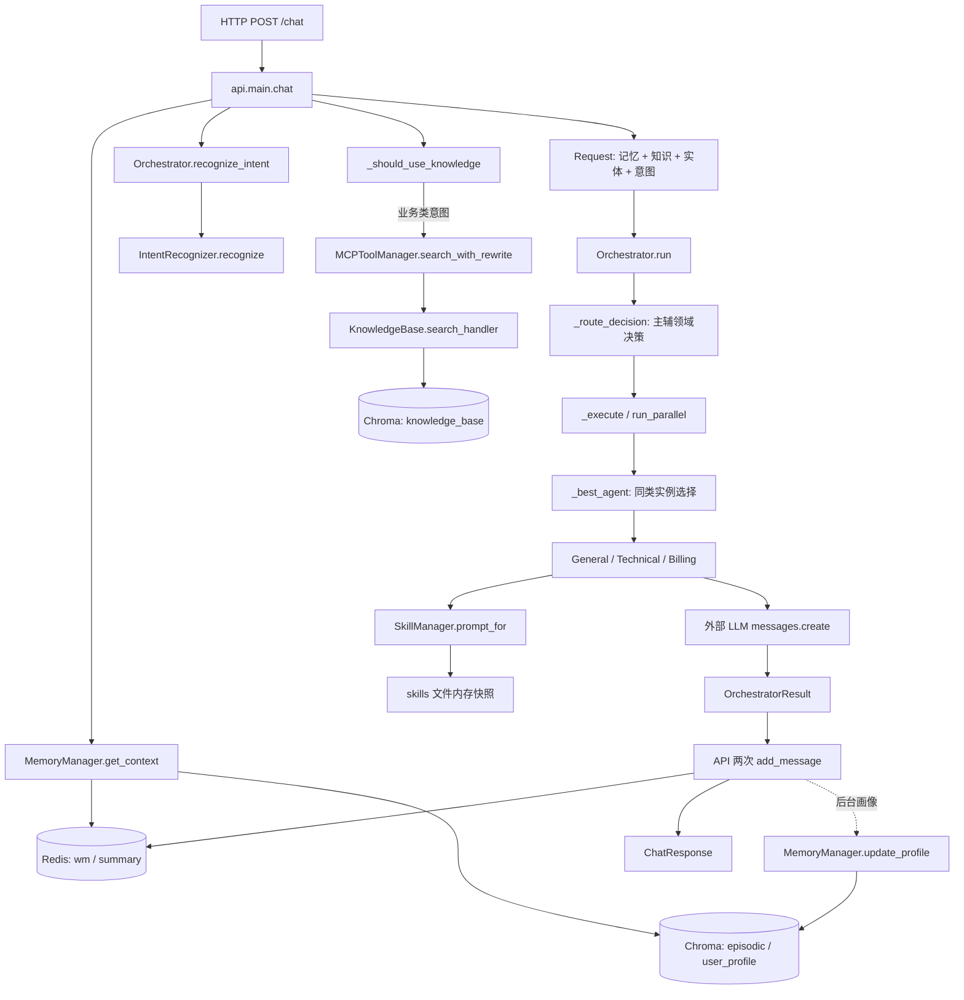
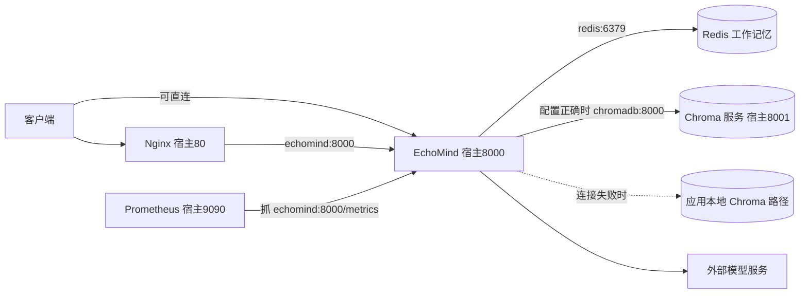
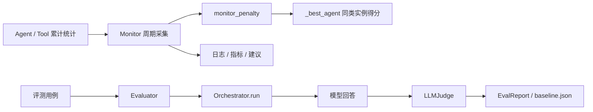

# 项目结构与真实调用地图

输入：HTTP/CLI 用户消息、配置、业务知识、历史会话。输出：客服回复与路由信息，以及记忆、统计、评测报告等状态。本页把“代码文件”“运行服务”“业务数据”分开，再连接起来。

## 先看目录的职责

```text
EchoMind/
├─ api/main.py                  应用装配；HTTP 路由；另一个 CLI 入口
├─ agents/agent_orchestrator.py  Request/Decision/Result；三类 Agent；路由与降级
├─ core/
│  ├─ intent_recognizer.py       LLM/向量/关键词融合、实体与紧急度
│  ├─ skill_loader.py            文件规则加载、匹配、prompt 预算
│  └─ llm_utils.py               模型响应文本适配
├─ mcp/
│  ├─ tool_manager.py            本地工具治理；查询改写、召回、重排
│  └─ knowledge_base.py          Chroma 知识库、切片和默认文档
├─ memory/conversation_memory.py Redis 工作记忆、Chroma 摘要/画像
├─ monitor/
│  ├─ __init__.py                空包初始化文件
│  └─ performance_monitor.py     周期采集、告警、实例降权
├─ evaluation/evaluator.py       分类评测、对话裁判、基线比较
├─ skills/                      三份业务 SOP 与编写说明
├─ config/                      Nginx 与 Prometheus 配置
├─ data/
│  ├─ demo_docs/                 需要人工导入的演示材料
│  ├─ eval/baseline.json         现存历史评测快照
│  └─ chroma/                   SQLite/HNSW 存储文件
├─ Dockerfile                   构建应用镜像
├─ docker-compose.yml           启动应用及依赖服务
├─ build-image.sh               构建/推送包装脚本
├─ docker-deploy.sh             Compose 运维包装脚本
├─ run-image.sh                 单应用容器包装脚本
├─ requirements.txt             Python 直接依赖
├─ .env / .env.example*         实际配置与两份模板
├─ .gitignore / .dockerignore   Git 与构建上下文过滤
├─ README.md / wiki/            已有操作手册、架构图片和表达素材
├─ tools/、logs/                当前为空的工具预留/日志目录
└─ 项目解读与面试指南/           本次学习资料
```

逐项原文件与对应解读见[完整索引](00_逐文件索引.md)。`.venv` 是外部依赖，`.git` 是版本控制数据，`.idea` 是编辑器状态；这些不属于自研业务代码。

## 一张图看主调用链



这里最重要的连接是：**API 调用检索工具，检索完成后才调用 Agent**。`BaseAgent._call_llm` 没传 `tools` 参数，也没处理 `tool_use`。因此当前不是“模型边思考边自主挑工具”的循环 Agent，而是固定工作流中的角色生成器。

## 启动顺序与组件所有权

实际容器启动命令在 [Dockerfile 解读](逐文件/Dockerfile.md)：`python -m uvicorn api.main:app --host 0.0.0.0 --port 8000`。

1. 导入 `api.main`：调整模块搜索路径、`load_dotenv()`、日志配置、创建 FastAPI、注册路由。此时全局组件还是 `None`。
2. FastAPI 进入 `lifespan`：读取模型配置，建立评测用识别器、SkillManager、编排器、记忆管理器、工具管理器和知识库。
3. 注册一个 `knowledge_search` 工具，其 handler 是 `kb.search_handler`，带 schema、300 秒缓存、fallback。
4. 启动 Monitor 后台采集；创建 Evaluator 并读基线；到 `yield` 后开始服务。
5. 退出 `yield`：停止 Monitor、关闭 Redis。多个模型客户端/画像任务没有统一清理。

`_orchestrator` 等全局变量是**单进程共享**，不是跨进程单例。若部署多 worker，每个进程都有自己的意图缓存、工具缓存、Agent 统计、Skill 快照和 Monitor；Redis/远程 Chroma 才能跨进程共享数据。

## 五个运行服务不是五个 Agent



三类 Agent 是同一个 Python 进程中的对象，使用同一模型配置和共享客户端；不是三套独立容器。Redis 负责短期列表/字符串，Chroma 的三个 collection 分别服务知识、情景摘要和画像。Nginx 代理流量，Prometheus 拉指标，不负责生成客服答案。

容器间使用服务名和内部端口。现有 Compose **未显式覆盖 Chroma HOST/PORT**；模板的 `localhost:8001` 是宿主方式，进入应用容器后含义不同。自动本地 fallback 会掩盖这一配置错误。

## 两条治理链路



监控反馈读取“调用成功率和累计平均延迟”。评测读取“分类对错、模型回答质量”。二者当前没有质量评分自动回灌到路由的连接。由于评测调用同一个在线编排器，它也会改变在线 Agent 统计，可能让测试流量干扰在线反馈。

## 哪些入口包含哪些能力

| 能力 | HTTP `/chat` | CLI `_cli` | Evaluator 对话 |
|---|---|---|---|
| 真实 MemoryManager 读写 | 有 | 有 | 无，只有本用例列表 |
| 意图识别 | API 预先识别 | 编排器内部识别 | 编排器内部识别 |
| 实体填入 Request | 有 | 缺失 | 缺失 |
| RAG 改写/召回/重排 | 有，受意图门控 | 无 | 无 |
| Skills | 有 | 有 | 使用所注入的编排器配置 |
| 多角色生成/路由 | 有 | 有 | 有 |
| 画像更新 | 后台 | 无 | 无 |
| 质量裁判与基线 | 无 | 无 | 有 |

## 本层结论与设计缺口

把 HTTP 主链路讲清就掌握了系统骨架；把入口差异讲清就掌握了集成边界。接下来应提取统一 `ChatService` 让 HTTP/CLI/评测复用业务用例，使用显式组件注入取代全局变量和私有字段反查，并将依赖健康、实际后端模式和配置生效状态公开到受控诊断接口。
