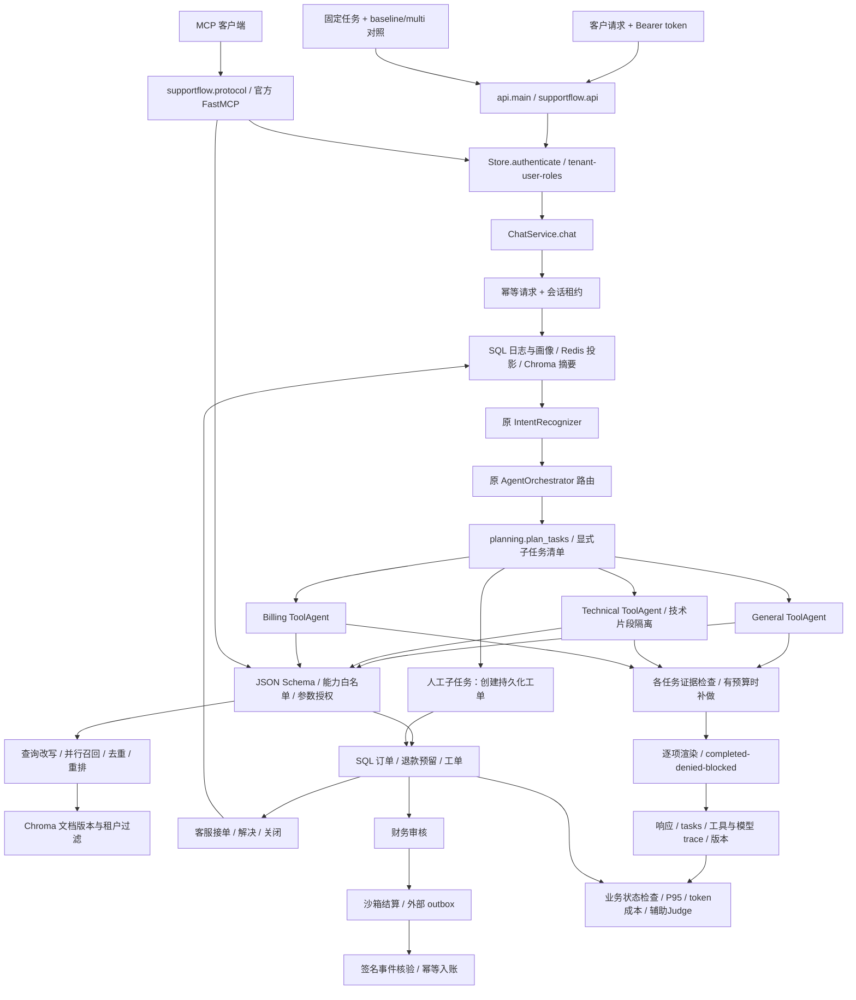

# SupportFlow v2：从会答问题到可验证的业务执行

你需要建立的核心认识是：**LLM 提出业务动作，后端依据身份和状态决定能否执行，评测再从最终状态判断有没有完成。** 回复文本、工具调用成功、业务完成，是三件需要分开观察的事。

这份文档说明 2026-09-08 后续改造。00–07 是改造前源码快照；不再用其中旧行号或“尚未实现”清单判断当前版本。新增代码的逐行索引见 [v2 逐行解读](v2逐行解读/README.md)，启动命令见 [运行指南](../SUPPORTFLOW.md)。

## 1. 当前结构地图

| 文件 | 读它时关注的核心问题 |
|---|---|
| `supportflow/contracts.py` | 什么可以来自客户端，什么必须由服务器生成？ |
| `supportflow/store.py` | 两个请求同时修改余额，哪个事务保证不超退？ |
| `supportflow/model.py` | 如何切换模型而不丢掉真实 usage、超时和错误？ |
| `supportflow/knowledge.py` | 文档如何版本化、跨租户隔离、去重和检索？ |
| `supportflow/tools.py` | 为什么模型想调用一个工具，不代表有权调用它？ |
| `supportflow/service.py` | 一次会话怎样把记忆、路由、工具、回复与提交连接起来？ |
| `supportflow/planning.py` | 怎样拆分任务、隔离技术输入、判断缺失并逐项交付？ |
| `supportflow/pricing.py` | 为什么按每次调用长度分档计费，再汇总任务费用？ |
| `supportflow/protocol.py` | MCP 协议层与业务工具层有什么区别？ |
| `supportflow/api.py` | 客户、客服、财务、运维、管理员的权限边界在哪里？ |
| `supportflow/payments.py` | 网络超时以后，怎样避免重复退款或误报到账？ |
| `evaluation/full_chain.py` | 为什么评测必须经过 HTTP，而不是单测 Agent 文本？ |
| `evaluation/public_intents.py` | 外部数据集如何映射标签，哪些结果不能混在一起？ |
| `evaluation/compare_runs.py` | 如何保留旧基线并检测退化？ |

原 `core/intent_recognizer.py`、`agents/agent_orchestrator.py`、`core/skill_loader.py` 被新版复用，不是重新写一套互不相干的路由。新增 `ToolAgent` 把原来的一次文本生成扩展为有预算的“决策—执行—观察—回答”。旧 MemoryManager、MCPToolManager、Monitor、Evaluator 保留为历史实现，新主入口已由新版对应模块承担。

## 2. 用一笔退款串起整个系统

输入：“我要申请订单 ORD1001 退款20元，原因是重复购买。”HTTP token 解析得到 `tenant=demo,user=alice,roles=customer`。

1. `ChatInput` 拒绝额外字段。因此客户端不能加 `roles=['finance']` 来获得财务权限。
2. `chat()` 对消息、会话 ID、实验方案生成指纹。同一 request_id 若已完成，返回保存的响应；换内容则冲突。
3. 同一会话拿到带过期时间的数据库租约，阻止并发轮次覆盖状态。用户身份还必须与会话属主一致。
4. 读取顺序历史与用户显式画像，识别退款意图和 `ORD1001/20元` 实体，构建业务上下文。
5. 账单 Agent 输出结构化工具调用。模型可以请求 `refund_request`，但没有 `approve_refund` 或 `settle_refund` 能力。
6. 执行层先校验 schema、能力、用户是否明确申请退款、订单与金额是否来自用户。`20元` 换算为整数 `2000分`，不用浮点金额参与账本计算。
7. SQL 事务读取订单归属、已退金额与 pending/approved/processing 预留金额。只有总和不超过订单实付金额，才能创建 pending 申请。
8. Agent 根据工具返回的申请 ID 和 pending 状态回答。此时正确表达是“已提交申请，等待财务审核”，不能说“已到账”。
9. 财务使用自己的身份审核，申请者即使也具有财务角色，仍不能审批自己的退款。
10. 沙箱 settle 在事务中更新已退金额与退款状态；重复 settle 返回同一结果。外部模式进入 outbox，只有核验过的支付结果事件才能入账。

你真正应该记住的是：幂等键解决“同一动作重放”，额度预留解决“不同动作并发超退”，审批分权解决“谁可以让申请变成付款”。这三个问题不能只靠一句 system prompt 解决。

## 3. 多 Agent 设计中真实的取舍

原路由器仍提供意图相关路由与置信度。当前默认 multi 路径通过 planning.plan_tasks 建立显式任务清单，为各事项指定负责人及工具证据门槛。各任务独立执行、检查和有限补做，最终由 render_tasks 逐项渲染，不再让模型自由合并。旧并行与模型合并仅保留在 legacy_multi 消融路径。

一个例子是“登录401，还要给订单申请退款”。技术 Agent 通过知识库取得登录排查依据，账单 Agent 申请退款；它们共享同一用户身份，却拥有不同工具白名单。上下文共享不等于权限共享。

多 Agent 带来额外工具循环、证据检查和可能的补做成本。简单问题不应强行并行；小模型也可能误路由、漏调用、反复调用或合并时丢掉细节。因此不能预先写“多 Agent 必然提升准确率、降低延迟”。实验中 baseline 是同一个模型和全工具通用 Agent，multi 同时引入角色 SOP、路由与增强检索；这是组合方案对比。已另跑 legacy_multi 与 multi 的同模型编排消融；single+增强检索、multi+单次检索等更细消融仍可补充。最新数据见[GLM实测汇总](../评测结果/GLM-复合任务实测.md)，详细设计见[第10章](10_复合任务改造与GLM实测.md)。

面试可以这样解释：“我首先保证基线具备完成任务的工具能力，再比较角色分工与检索策略的组合收益。完成率、延迟和成本一起看，只有数据支持时才说提升。”

## 4. RAG 如何变成可审计的工具

知识条目有文档 ID、内容哈希版本、稳定 chunk ID。切分采用 500 字符上限、420 步长，避免软切分产生超长片段。检索始终带租户过滤，结果还会对照 SQL 当前有效 ID，避免向量投影滞后时引用已替换的版本。

增强路径：原查询 → 最多两个模型改写 → 并发检索 → 按 chunk ID 去重 → 模型输出候选索引顺序 → 校验索引、补齐遗漏候选 → top-k。改写与重排失败不能虚构候选，而是保留原查询结果并记录降级。

这里的去重依赖稳定身份，不是比较包含 score 的整个字典。缓存键包括租户、用户、角色、查询参数、检索模式和知识版本，避免跨权限重用结果，也避免文档更新后继续命中旧结果。

当前默认 Chroma 内置 MiniLM embedding；本次已在本机完成真实向量入库与查询。它能运行，不代表已证明最适合中文客服。更换中文/多语言 embedding、加入检索标注集、报告 Recall@k/MRR/引用正确性，是进一步验证检索质量的明确方向。

## 5. 为什么记忆需要一个权威存储

SQL 保存原始顺序日志、会话状态、显式画像与幂等结果，Redis 保存工作历史缓存，Chroma 保存摘要与画像投影。缓存和向量存储发生故障时，业务源数据不会因此丢失。

同一会话租约保护聊天轮次的顺序；人工解决说明允许异步写入日志，读取缓存时还要与权威历史比对，不能只看聊天轮数。历史较长时做有界摘要，但保留原始 SQL 日志，因此摘要丢信息不会不可逆地删掉证据。

当前画像只记录用户明确说过的偏好，例如“用中文”“简短”，不让模型猜测敏感属性。摘要也不替代订单账本：用户过去说“退款成功了”不能让数据库余额自动改变。

设计代价是 SQL 写入事务与缓存一致性处理增加复杂度。当前 SQLite WAL 适合本机与小规模演示，不等价于已验证的多机高吞吐数据库；真正部署应评估 PostgreSQL、租约续期、共享限流、投影重建任务、数据保留和备份恢复。

## 6. 人工闭环与 MCP 的区别

人工闭环必须存在工单 ID、持久状态、受理人、版本与解决说明。open → assigned → resolved → closed 的每次变化都校验角色；解决时写回原会话，用户可以再次查询。把响应字段设成 `escalated=true` 不足以构成人工闭环。

MCP 则是对外通信协议。新版使用官方 SDK 处理 initialize、工具发现和 Streamable HTTP 消息；调用最终落到同一组业务工具。测试使用真正的 SDK ClientSession 连接本机 HTTP 服务，验证握手与工具调用，区别于只给一个本地工具管理类取名 MCP。

当前权限是 tenant + user + roles + 资源属主校验，包含过期与撤销。MCP 与 HTTP 共用这套身份。企业 SSO、OIDC 登录流程和组织管理需要目标身份提供方；不要把当前 token 资源服务包装成已完整接入企业身份平台。

## 7. 评测怎样支持简历里的成果

原“几组对话 + LLM 评分”主要观察回答效果，无法证明模型真的完成退款或人工处理。新版的评测输入包含任务消息、沙箱初始化数据和期望状态；期望状态只给验证器，不传给 Agent。

| 观测 | 证据 | 不应混淆的东西 |
|---|---|---|
| 任务完成率 | 必需工具成功、最终金额/状态、人工回写 | 模型口头声称完成 |
| HTTP P95 | 客户端计时覆盖整条 HTTP 服务链 | 某个 Agent 的平均耗时 |
| token 与 API 费用 | 供应商 usage × 已确认单价 | 本地机器总成本 |
| 四维评分 | 评委模型真实输出、schema 校验 | 客观业务完成标签 |
| 英文意图泛化 | 公共数据映射后的标签与混淆矩阵 | 真实生产客服成功率 |
| 回归门槛 | 相同条件报告的相对差异 | 统计显著性或 SLA |

本次自建集固定 24 条，其中复合任务 8 条；前两条订单任务用于开发试跑，不能称为隐藏测试集。Bitext 另取 54 条，公开其来源、revision、SHA256、许可和映射，48 条进入意图评估。样本少且均含合成成分，下一步应由其他人标注与冻结更多业务样本，并保留失败分布、置信区间和真实用户反馈。

全链路报告按 single/multi 分组，每条原始记录都有业务状态和 trace。失败保留在分母；无 token 单价时成本为 null；本地外部 API 费用可以是 0，但不能说整台机器免费运行。评委错误单独计数，不用默认高分填补。

最终简历应从实际报告生成。如果 multi 没有超过 baseline，就写“搭建可复现实验并识别复合任务瓶颈”，不要写“显著提升”。即使超过，也要写明 N、数据类型、基线、并发、模型与测量边界。

## 8. 面试的三分钟讲述

“SupportFlow 面向客服中的复合诉求和工具执行不稳定。我复用了结构化意图路由，让通用、技术、账单 Agent 按任务协作，但把订单归属、退款余额和审批放在确定性的业务层，模型不能绕过权限直接付款。

退款采用整数金额、事务额度预留、幂等键和财务分权；人工升级会建立可跟踪工单，并把人工解决说明写回原会话。MCP 通过官方 SDK 暴露同一套工具，所以 HTTP 和 MCP 的权限及执行语义一致。

为了证明系统能力，我建立固定业务任务和单 Agent 基线，用完整 HTTP 链路运行，再检查数据库状态、工具 trace、P95 和 usage 成本。公共英文意图数据另做泛化测试，不混成业务完成率。模型质量与基础设施质量分别报告，真实支付商与企业身份接入按目标环境验证。”

随后插入本次报告中有证据的数字。被问到“为什么不用单 Agent”时，展示相同模型和工具下的实际对比与失败案例；被问到“是否生产可用”时，说明本地集成验证、沙箱边界、当前小样本结果与尚未完成的目标环境验证。

## 9. 当前仍值得增强的地方

外部支付商实际对账协议及定时调度接入（当前已有主动 reconcile 接口与回调丢失测试）；同一用户多会话画像更新的细粒度并发合并；跨进程工具熔断与共享配额；中文检索标注和 embedding 对照；Agent 结果的事实一致性校验；独立评委与人工校准；更多隐藏、多轮、对抗测试；真实容器环境的压测、恢复演练、日志隐私与保留策略。

这些方向应与报告一起解释，不能把“存在配置或接口”当成已得到生产证据。你真正应该记住的是：项目的工程价值不仅是让模型完成一次演示，而是让身份、动作、失败和结果都能被追踪与验证。
