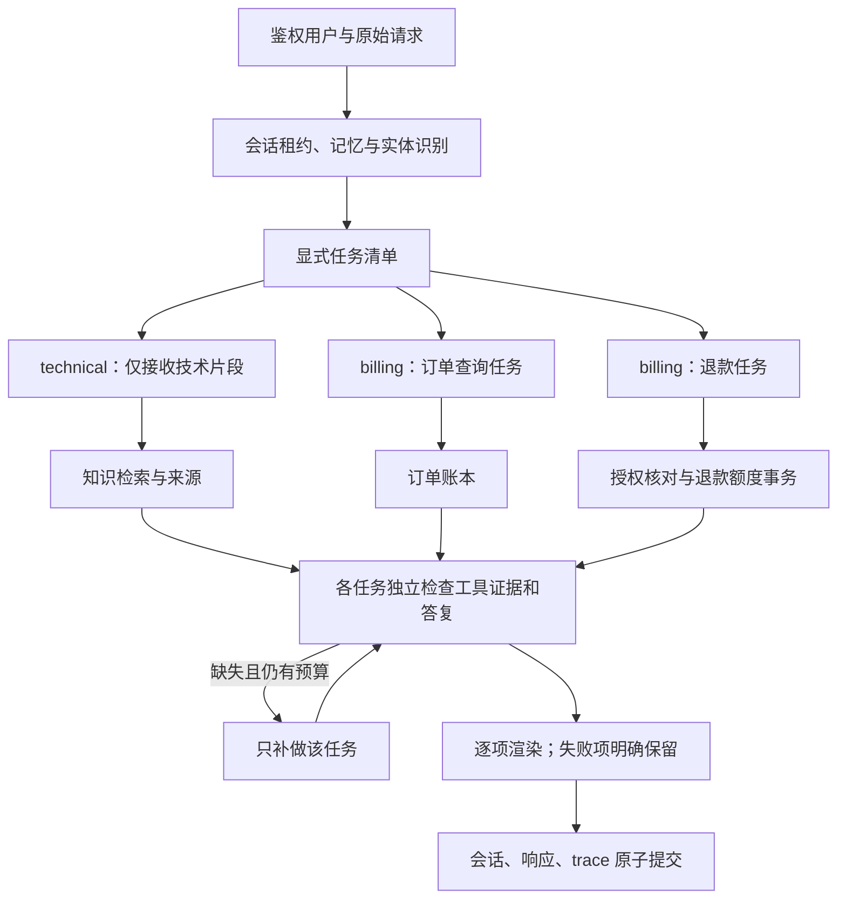

# 复合任务改造：从“同时回答”到“逐项交付”

这次改造集中于 `supportflow/planning.py`、`service.py`、`model.py`、`pricing.py` 和 `evaluation/full_chain.py`。每个文件的输入输出、代码快照与逐行说明见同目录 `v2逐行解读`；真实结果由评测报告单独记录。

## 从一个例子讲清楚整体逻辑

用户说：“登录报401，请查询订单ORD1001的状态，并申请退款8元。”旧版把整段话发送给几个 Agent，再让模型合并。一个 Agent 可能只顾退款，另一个又为订单创建工单，最后合并还可能丢掉排障步骤。

新版先建立三个任务：技术排查交给 technical，订单查询和退款分别交给 billing。Agent 类型可以相同，但任务状态和观察结果独立。技术任务必须取得知识来源并给出可执行步骤；订单任务必须查到真实订单；退款任务必须实际建立 pending 申请。客服回复“已经处理”不能代替工具证据。

图中的循环是同一子任务内部的有限补做，执行时不会重新启动整张任务清单。每个子任务默认最多经历四次模型决策；最后一次禁止继续调用工具。整体请求仍受超时与并发限制。

## 关键设计为什么这样选

**职责隔离要落实到输入和工具集合。** 单靠“不要回答其他问题”的提示，真实 GLM 调用仍出现跨任务回答。现在技术 Agent 只接收技术片段，移除订单实体，并只暴露知识检索工具。完整原文留在执行层，退款订单和金额仍必须与原始用户授权一致，不能依据模型改写后的请求扩大权限。

**并行写入需要请求级协调。** 一次请求的工单摘要统一取原文，退款原因同样固定。相同工具和规范化参数通过锁共用成功结果，避免两个 Agent 抢着创建。数据库继续保留“相同幂等键、不同业务载荷报冲突”的规则；不能为了消除报错而删除这条保护。请求级共享只覆盖当前可信用户和当前请求，不跨用户复用写入结果。

**最终完整性优先于自由合并。** 每项保留独立标题、答复和证据。验证不通过时，返回该项未完成和缺失原因，整个响应为 partial。此处的 completed 表示当前客服任务的交付门槛达成，例如给出排障步骤、提交待审核申请；它不代表用户已经成功登录，更不代表退款到账。

超额退款还有一种正常终态：数据库明确拒绝后，任务可以为 `denied`。这表示按规则完成拒绝处理，不能把超时或权限不明当作业务拒绝。验证器仍检查实际金额、退款条数与状态，所以不能用 denied 代替本应成功的退款申请。

**模型能力和编排收益必须分开测。** `single` 与 `multi` 使用相同 GLM、同一知识库和业务接口；`legacy_multi` 与 `multi` 对比旧式并行合并和显式任务协调，公共工具保护相同。不能把之前 Qwen 的 0/8 直接当作 GLM 编排改进的归因证据。

## 怎么判断实验可信

固定用例从鉴权 HTTP `/chat` 进入真实服务，实际调用 GLM 和 Chroma，最后检查数据库中的退款状态、金额与人工工单闭环。期望标签只进入测试验证器，不进入 Agent。回复核验还检查订单事实、401排查内容、来源及虚假到账声明。新增 task_coverage 检查避免“总体工具齐了，但一个子任务仍失败”被算成功。

保留逐例请求、答复、工具参数、真实结果、任务状态、token 和耗时；失败留在分母；计算配对差和区间。正式运行记录源文件哈希，运行中改代码的结果必须标明不可直接采用。LLM-as-Judge 使用同一个模型，仅作为辅助四维评分，不能代替状态检查或独立人工评审。

v1 的24条任务及其8条复合子集都已经用于开发调试。v2新增8条复合回归，包含三诉求、人工跟进、发票、否定退款、缺失信息、500错误和小数金额；这些仍是自编开发回归，不是独立盲测，更不是生产流量。

## GLM 接入和成本口径

官方 GLM 接口使用 `json_object`；schema 放入提示并在本地校验。不能把它写成“供应商强制满足 JSON Schema”。本次关闭思考模式，保留真实 token usage，模型选择和配置写入报告。

GLM-Air 的价目表按每次请求的输入、输出长度分档。估算函数逐次计算后汇总；评审模型单列 token。估算没有扣缓存折扣、套餐和赠额，不能替代账户账单。官方依据：[API参数](https://docs.bigmodel.cn/api-reference/模型-api/对话补全)、[GLM说明](https://docs.bigmodel.cn/cn/guide/models/text/glm-4.5)、[价格](https://bigmodel.cn/pricing)。

## 面试表达与尚未完成的边界

可以解释：“我把复合客服请求建模为带负责人、必需工具和完成状态的任务清单。Agent 根据分工获取有限上下文和工具权限；执行层复用同请求的成功结果并保持事务幂等。每项根据真实工具证据检查是否交付，缺失时有限补做，最终逐项返回，避免并行回答和自由合并导致遗漏。”

当前规划器覆盖已支持客服领域，仍是规则规划，不能称为任意复杂任务的通用 DAG。订单/退款跨多笔交易的指代、复杂否定范围、长链依赖和任务取消仍需增强。关键词和工具门槛也不能证明回复的全部语义正确；真实调用中仍可能出现知识来源外的补充建议。需要更大的人工标注集、独立评审、多次重复实验和生产回放，才能证明泛化收益与 SLA。真实支付商生产接入与企业 SSO 仍遵循之前记录的集成边界。

人工抽查还发现，账单 Agent 偶尔会附带重复的技术建议；目前的验收门槛侧重任务不遗漏、工具状态正确和失败可见，不把它包装成“已消除所有重复和幻觉”。技术上下文已做片段隔离，其他领域的细粒度上下文筛选与回复去重仍是可继续优化的部分。

新版任务执行直接进入受控工具循环，不走旧 router 的自动通用 Agent 回退。讲监控时应引用返回的 `tasks`、请求 `trace` 和实际 HTTP/工具指标，不能把旧 `BaseAgent.handle` 的内存统计当作新版完整的 Agent 运行指标；逐 Agent 延迟、取消和跨进程状态仍可补强。
