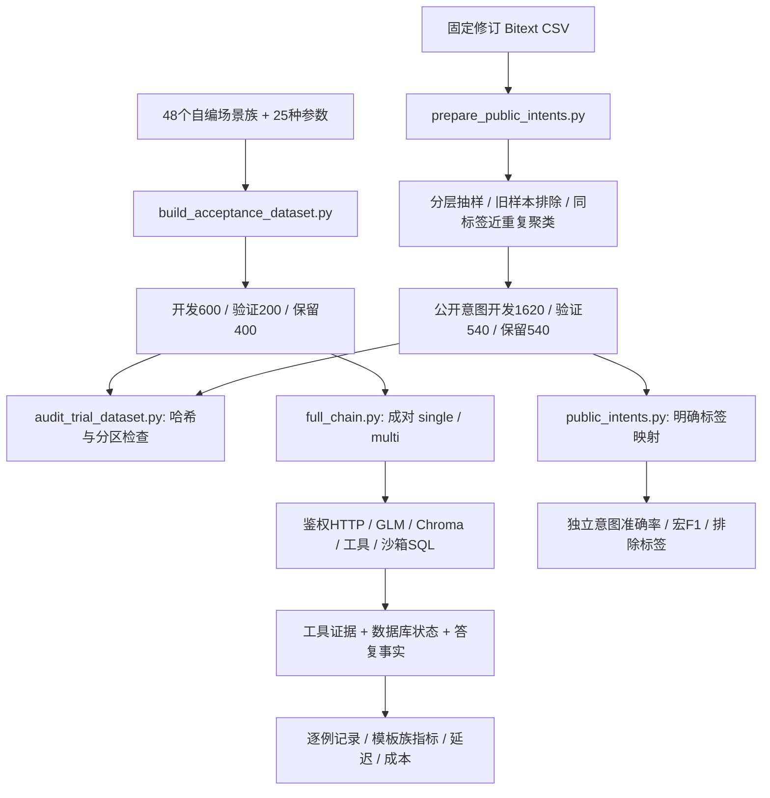

# 面向企业试用的分层数据与验收方案

2026-09-09。本次将“24条自编回归”扩展为一套可交付的数据准备、执行、核验和报告流程。项目实际定位是面向企业客服试用的工程原型；没有发生的企业合作、客户数据授权或验收签字不能写入项目经历。

## 为什么准备这个规模

24条适合修改代码后快速回归，难以说明不同金额、权限、表达方式和上下文长度下的表现。企业试点通常要先约定业务范围和验收口径；具体数量取决于场景、风险、业务分布与评审成本，并无本项目已证实的统一行业数量。

这里采用1,200条业务任务作为工程起步规模：48个场景模板族，每族25个业务参数。600条开发、200条验证、400条验收保留，并另备2,700条公开英文意图样本。前者验证“是否办对事情”，后者观察“能否理解不同用户表达”，两类指标分别报告。

这个规模主要扩大业务边界覆盖，并没有让自然语言多样性自动增加50倍。能够解释“48族、1,200实例、按族分区与统计”，比只报一个大数字更经得起追问。未来真正试点时，应优先补充独立自然表达、不同业务政策和真实失败场景，继续机械替换订单号收益很低。

## 从数据到证据的地图

输入标签不能泄漏给业务 Agent。只有用户消息发给 `/chat`；夹具在评测环境预先建立真实可查询状态，金标由外部 verifier 使用。两个方案各自拥有隔离数据库和身份，工具缓存从冷状态开始；模型预热单列，调用顺序交替，失败留在分母。

`prepare_fixture` 可建立其他用户或租户的订单，也可让知识检索真实抛异常。这样验证的是权限边界和工具失败后的处理，而非仅靠提示词要求模型“假装没权限”。`verify` 检查实际成功工具、参数、账本与逐项答复；`aggregate` 同时统计实例完成率和模板族等权完成率。

全链路采用ASGI进程内HTTP，包含本机鉴权、服务和存储，以及真实模型网络调用；不包含公网入口与反向代理。工单关闭由测试程序模拟客服；退款申请保持 pending，不代表实际资金到账。

## 验收怎么分阶段

1. **数据审计**：核对来源、许可、模板与金额标签、分区、哈希；人工评审48族及高风险边界。当前自动审计已做，独立人工复核仍待做。
2. **开发回归**：先运行开发集中的8条冒烟任务，确认鉴权、模型、检索、账本和报告都能贯通，再用600条开发任务定位问题。8条是子集，不重复计算总量。
3. **版本候选验证**：200条验证集用于候选版本选择。输出完整失败清单和人工复核记录，不能只挑成功例做演示。
4. **冻结后验收**：冻结模型、代码、提示词、知识版本、数据与门槛，再运行400条保留任务。观察失败后调参就形成暴露记录，下一轮需新场景。
5. **实际试点**：获得真实合作和授权后再补真实脱敏表达、业务规则确认、目标部署的并发稳定性、外部支付和人工运营验收。当前没有这些已完成证据。

建议门槛见[完整数据卡](../evaluation/datasets/trial-v3/README.md)，均为方案目标。例如越权读写和资金错误为0、复合任务按族完成率至少90%；时延与成本上限应结合交付环境商定。开发集通过、单次验收通过和生产持续达标是不同层次的结论。

## 面试中解释设计选择

**为什么没直接下载几千条客服语料测完成率？** 多数公开意图语料没有本系统的订单、资金和工单状态。只能判断分流，不能证明退款正确。业务任务需要能执行的夹具和状态金标，公开语料作为独立泛化视角。

**如何避免数据泄漏？** 参数化任务按完整模板族分区，校验去实体和金额后的重复。公开数据先排除旧54条及近邻、在同标签候选池聚类取代表，再分区。它减少词面泄漏，不能保证语义独立，也不知道模型是否预训练过公开源。

**为什么不只用LLM打分？** LLM可能被流畅文字误导。资金、身份和工单以系统状态为准；答复完整性用逐项门槛辅助，Judge用于四维质量观察，最终还要人工复核。关键词组本身也可能误判，所以不把它叫完整语义证明。

**样本是否独立？** 不是。1,200实例来自48族，实例统计可能低估不确定性，因此报告按族宏平均和配对族级bootstrap。验收16族也不足以推出全业务生产质量。

**和单Agent比较是否公平？** 使用相同模型、工具、业务保护、数据、身份和并发条件；变化是编排方案。single仍可调用所有业务工具，legacy_multi可单独消融任务规划。当前实验只是有限场景的对比，不能据此宣称多Agent在所有问题上更好。

## 当前可用的简历表述

> **评测工程：** 构建面向企业客服试用的分层验收数据包，覆盖8类业务场景、48个场景模板族与1,200个可执行参数实例，按模板族隔离开发、验证和验收保留集；另从公开Bitext语料准备2,700条分层意图样本，完成来源追踪、近重复过滤与数据完整性审计。
>
> **验证机制：** 搭建鉴权HTTP到Agent、检索、工具及沙箱账本的成对评测，联合校验工具参数、退款状态、越权访问、工单闭环和复合答复，并输出按模板族统计的完成率、P95延迟及模型调用费用估算。

这里可以写“准备了1,200条”，当前不能写“1,200条全部通过”“企业提供数据”或“完成企业验收”。真实合作存在后，才可补合作职责与验收结论。历史24条和8条的实际结果继续按原数据版本引用，不能与新数据拼成一个提升指标。

## 证据入口与增强方向

本轮50项自动化测试通过；GLM-4.5-Air实际运行开发集8条子集，最终single 7/8、multi 8/8。初次single 6/8中有一例“待财务审核”未命中“待审核”，修正评测器同义状态规范化后重新调用模型，并保留初次记录。此过程是开发校准，不能将差值当独立质量提升证据。最终任务并发2，multi请求P95为9.83秒，模型费用按历史价目表估算0.00632元/任务；未运行Judge。

完整开发600条、验证200条、验收400条及新增公开意图集尚未执行模型评测。数据完整性审计通过只说明生成物结构与分区满足检查，不说明这些任务都能被模型完成。

- [v3开发冒烟实测及判分修正记录](../评测结果/GLM-v3开发冒烟实测.md)
- [完整数据卡及运行命令](../evaluation/datasets/trial-v3/README.md)
- [业务数据清单与哈希](../evaluation/datasets/trial-v3/manifest.json)
- [公开数据清单与许可](../evaluation/datasets/trial-v3/public-manifest.json)
- [离线完整性审计](../evaluation/datasets/trial-v3/integrity-audit.json)
- [逐行代码索引](v2逐行解读/README.md)

后续优先增强独立人工金标、更多自然表达和政策差异、跨订单指代、语义事实验证与独立验收执行。新增公开语料数量不能替代中文复合任务数据，也不能替代真实企业运行环境的验证。
